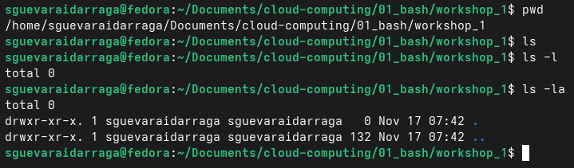
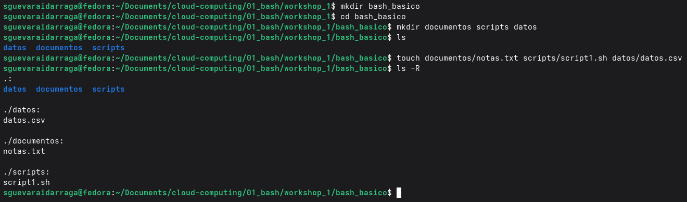
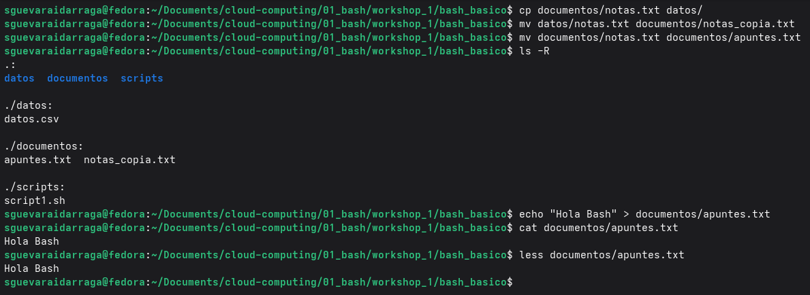
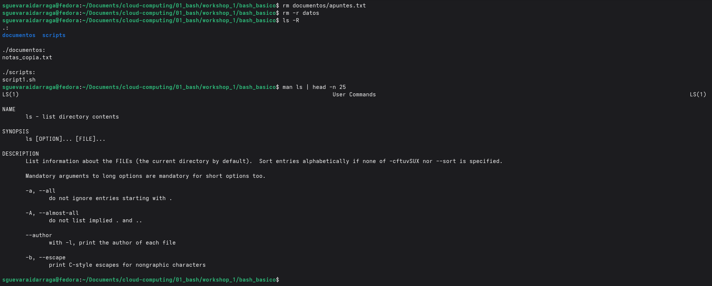
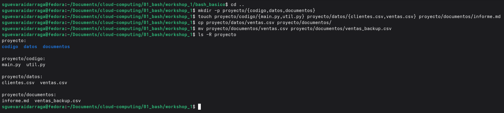
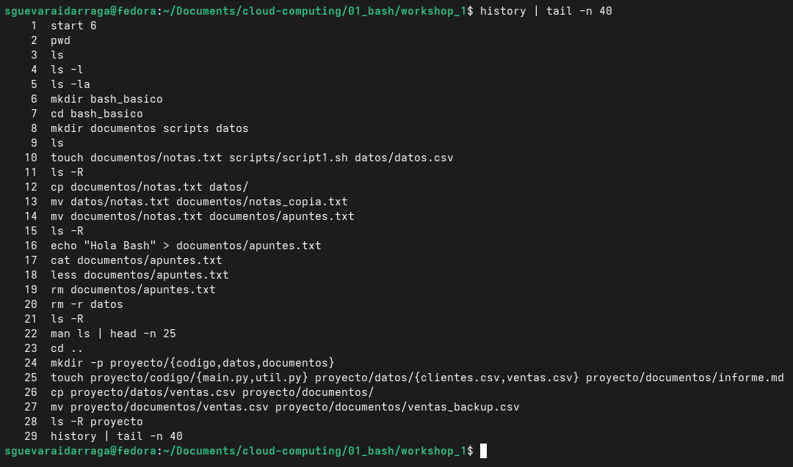

# Taller 1 - Bash

## Parte 1. Conociendo la terminal

**Ejercicio 1**
1. `pwd` significa *print working directory*. Muestra la ruta completa de la carpeta donde estoy parado en la terminal.
2. Aparece la carpeta del taller, `workshop_1`, como se ve en la captura.

**Ejercicio 2**
- `ls` solo muestra los nombres. `ls -l` muestra una lista detallada con permisos, dueño, tamaño y fecha. `ls -la` hace lo mismo pero además incluye los archivos ocultos.
- Los archivos ocultos son los que empiezan con un punto. Normalmente guardan configuraciones y por eso `ls` no los muestra si no se usa `-a`.

## Partes 2 y 3. Navegación y creación de archivos

## Partes 4 y 5. Copiar, mover y visualizar contenido

## Partes 6 y 7. Eliminación y ayuda

## Reto final

## Historial

## Preguntas de reflexión
1. Una ruta absoluta empieza desde la raíz `/` y funciona sin importar dónde esté parado, por ejemplo `/home/usuario/documentos`. Una ruta relativa se calcula desde el directorio actual, por ejemplo `documentos/notas.txt`.
2. `cd ..` me lleva un nivel arriba, al directorio padre del actual.
3. `man` sirve para abrir el manual de un comando y ver para qué sirve, cómo se usa y qué opciones tiene.
4. El riesgo de `rm -r` es que borra una carpeta con todo su contenido sin pedir confirmación y sin papelera. Si me equivoco en la ruta, puedo perder información importante sin poder recuperarla.
