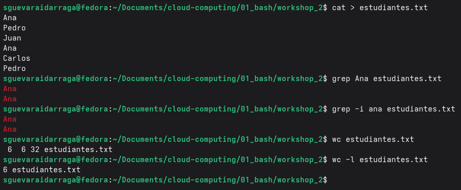
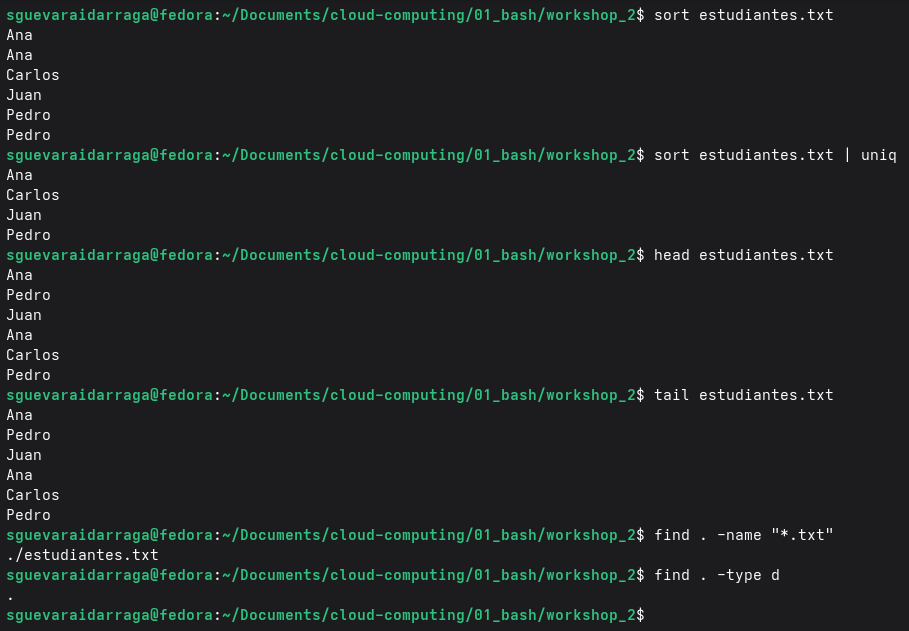
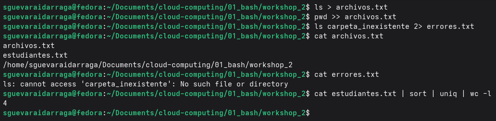
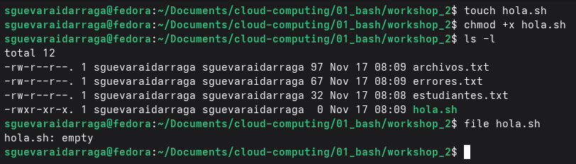
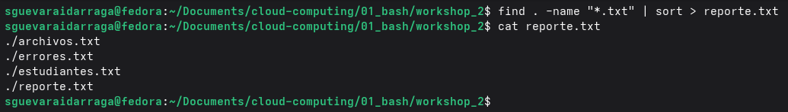

# Taller 2 - Bash

## Ejercicios 1 al 3. Crear archivo, buscar y contar

## Ejercicios 4 al 6. Ordenar, primeras y últimas líneas, buscar archivos

## Ejercicios 7 y 8. Redirecciones y pipes

## Ejercicios 9 y 10. Permisos y tipo de archivo

## Reto
Busqué todos los `.txt`, los ordené alfabéticamente y guardé el resultado en `reporte.txt`.

## Preguntas
1. Una tubería (`|`) toma la salida de un comando y la usa como entrada del siguiente. Así se pueden combinar comandos sencillos para resolver tareas más grandes, como en `cat estudiantes.txt | sort | uniq | wc -l`.
2. `>` crea el archivo o reemplaza todo lo que tenía. `>>` agrega el texto al final sin borrar lo anterior.
3. `chmod +x` le da permiso de ejecución al archivo. Con eso puedo correrlo directamente, por ejemplo `./hola.sh`.
4. `grep` busca texto dentro del contenido de los archivos. `find` busca archivos y carpetas por nombre, tipo, tamaño y otras características.
