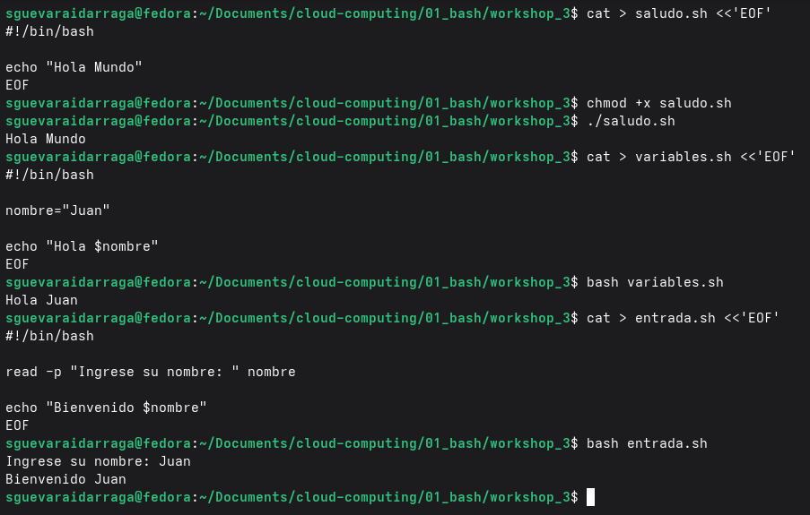
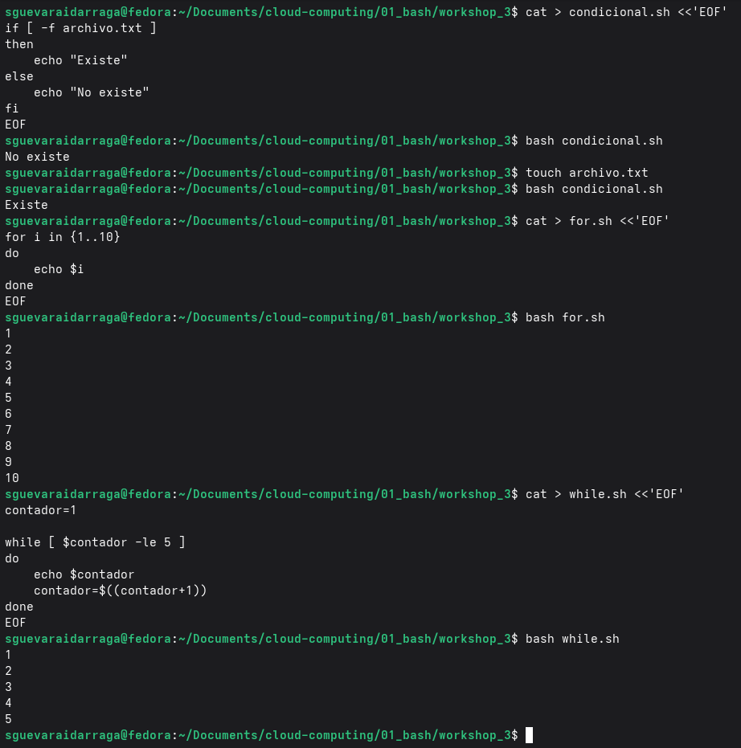
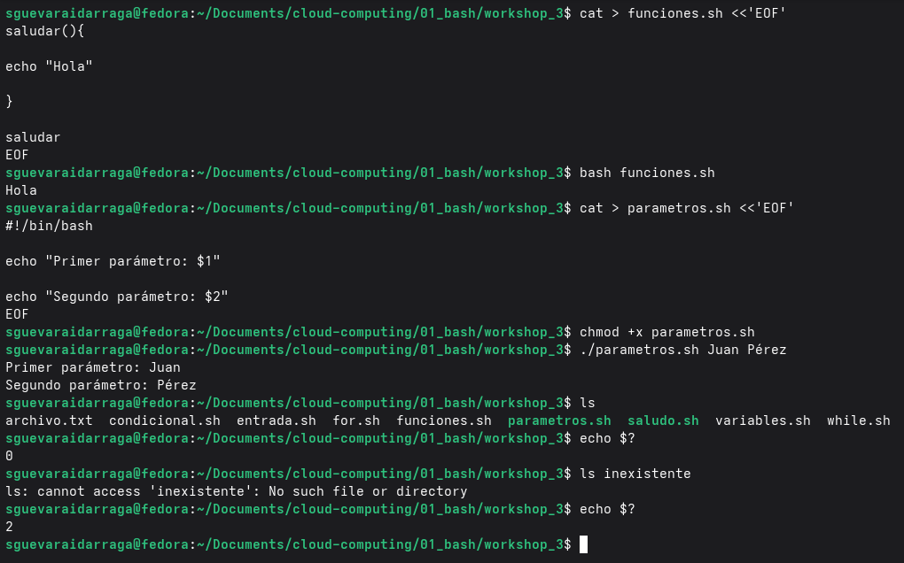
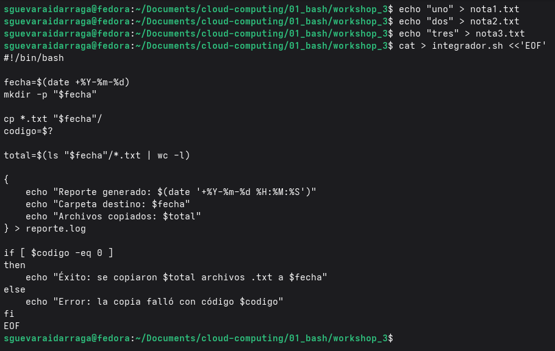
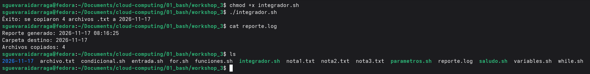
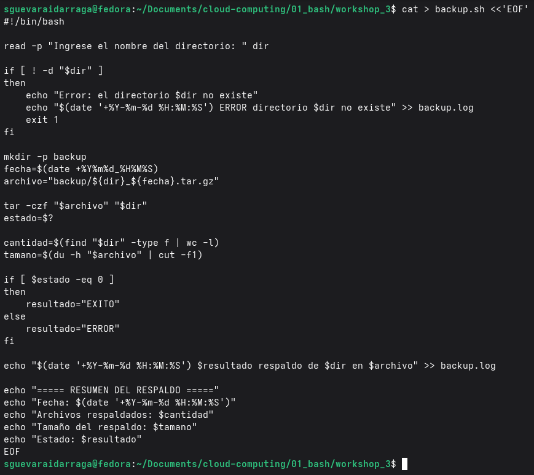
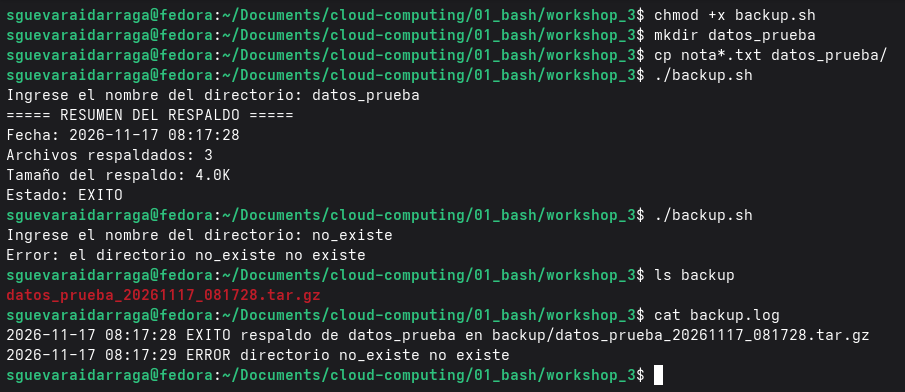

# Taller 3 - Bash

## Ejercicios 1 al 3. Primer script, variables y entrada

## Ejercicios 4 al 6. Condicional, for y while

## Ejercicios 7 al 9. Funciones, parámetros y código de salida

## Ejercicio 10. Proyecto integrador
Script `integrador.sh`:

Ejecución:

## Desafío final. backup.sh
Script `backup.sh`:

Ejecución con un directorio válido y con uno que no existe:

## Preguntas de reflexión
1. Un script permite repetir la misma tarea muchas veces sin escribir todo otra vez. Además reduce errores humanos, ahorra tiempo y deja un procedimiento documentado que otros pueden usar.
2. Uso `for` cuando sé de antemano cuántas veces o sobre qué elementos voy a repetir, por ejemplo recorrer una lista de archivos. Uso `while` cuando debo repetir mientras se cumpla una condición y no sé cuántas vueltas serán.
3. `$?` guarda el código de salida del último comando ejecutado. Un `0` significa que todo salió bien y cualquier otro número indica que hubo un error.
4. Porque si el archivo o la carpeta no existe, el comando puede fallar, dar resultados incorrectos o incluso dañar datos. Validar antes permite mostrar un mensaje claro y detener el script a tiempo.
5. Se pueden programar con `cron` o `systemd timers` para hacer respaldos, limpiar logs o revisar el estado de los servicios. En la nube se usan en scripts de arranque de las instancias y en pipelines de despliegue. En dispositivos IoT sirven para recolectar datos de sensores, enviarlos a un servidor y reiniciar servicios si fallan.
