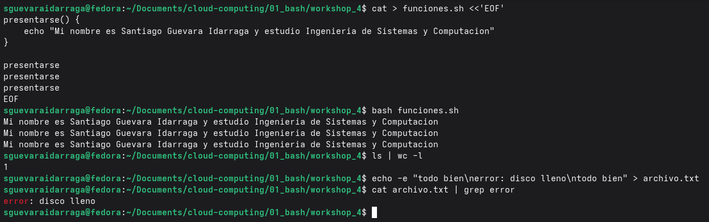
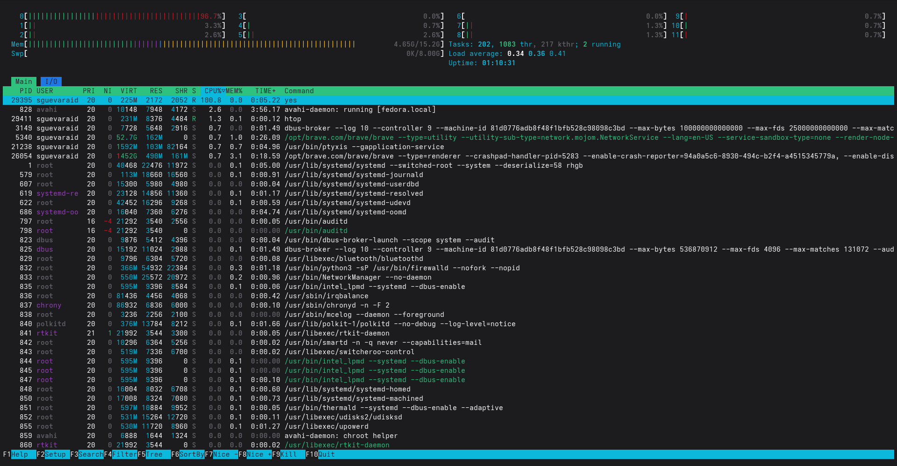
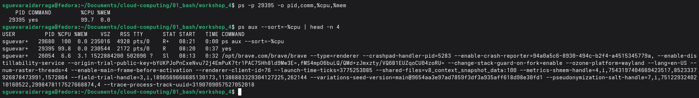
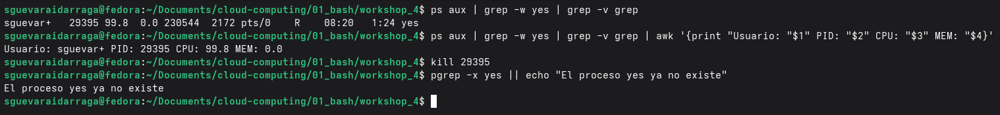
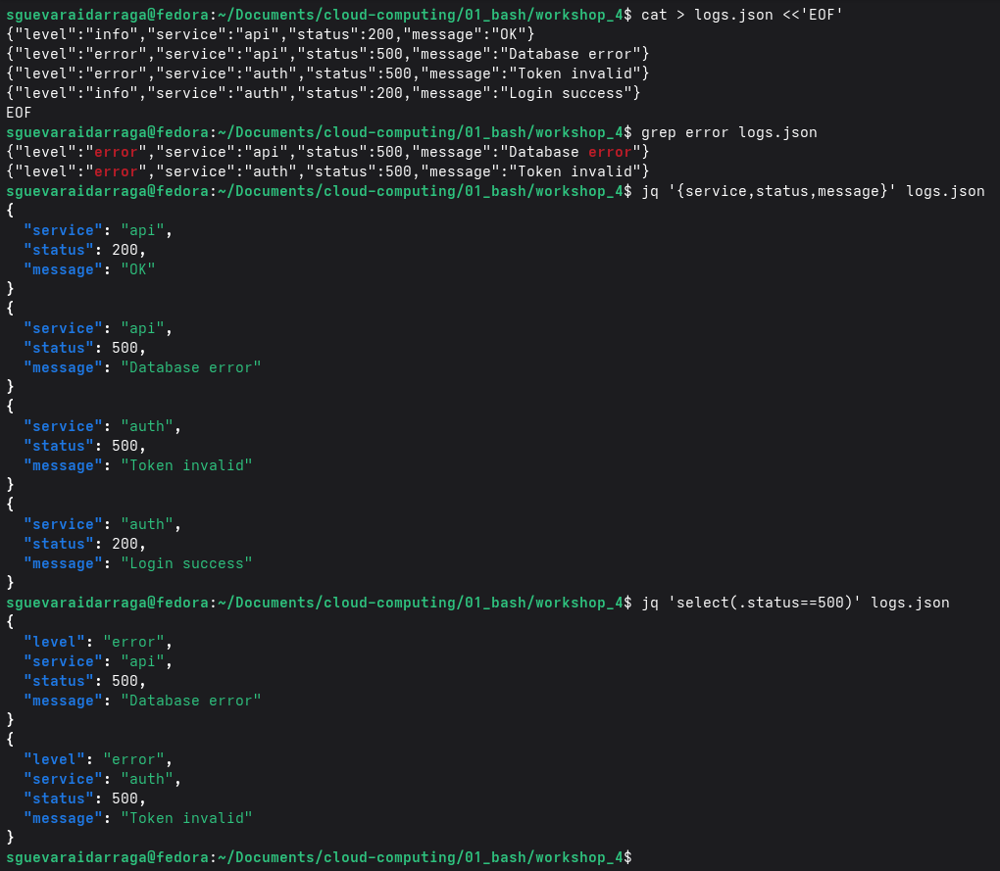
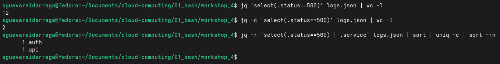
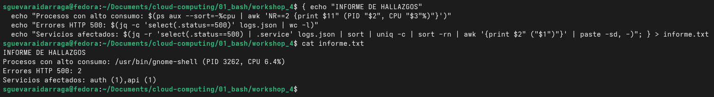

# Taller 4 - Bash

## Parte 1. Funciones y Parte 2. Pipes
Creé la función `presentarse` y la ejecuté tres veces. También probé los dos ejemplos de pipes.

**Actividad de la Parte 2**
- `ls | wc -l`: `ls` lista los archivos de la carpeta y esa lista pasa a `wc -l`, que cuenta las líneas. El resultado es la cantidad de archivos y carpetas que hay.
- `cat archivo.txt | grep error`: `cat` muestra el contenido del archivo y `grep error` deja solo las líneas que contienen la palabra error.

## Parte 3. Investigación de comandos

| Comando | ¿Qué hace? | Sintaxis | Ejemplo | Caso de uso |
|---|---|---|---|---|
| grep | Busca texto dentro de archivos o de la salida de otro comando | `grep [opciones] patrón archivo` | `grep -i error app.log` | Encontrar errores en un log |
| ps | Muestra los procesos que están corriendo | `ps [opciones]` | `ps aux` | Ver qué proceso consume más recursos |
| htop | Monitor interactivo de procesos, CPU y memoria | `htop` | `htop` | Revisar en vivo por qué un servidor está lento |
| kill | Envía una señal a un proceso, por defecto para terminarlo | `kill [-señal] PID` | `kill 1234` | Detener un proceso descontrolado |
| awk | Procesa texto por columnas o patrones | `awk 'programa' archivo` | `ps aux \| awk '{print $2}'` | Extraer solo ciertos campos de una salida |
| jq | Lee, filtra y transforma datos en formato JSON | `jq 'filtro' archivo.json` | `jq '.status' logs.json` | Analizar logs o respuestas de APIs |

## Parte 4. Proceso sospechoso consumiendo recursos
Para simular el problema lancé en segundo plano el comando `yes > /dev/null`, que consume CPU sin parar. Primero lo abrí en `htop`, donde aparece en los primeros lugares por CPU.

Luego registré PID, nombre, %CPU y %MEM con `ps`, lo verifiqué con `ps aux` y lo filtré con `grep`.

Después usé `awk` para mostrar solo usuario, PID, CPU y MEM, finalicé el proceso con `kill` y comprobé que ya no existe.

## Parte 5. Análisis de logs JSON

El comando del taller `jq 'select(.status==500)' logs.json | wc -l` devuelve 12 porque `jq` imprime cada objeto en varias líneas y `wc -l` cuenta líneas, no registros. Por eso agregué la opción `-c`, que deja cada objeto en una sola línea y da el conteo correcto de 2 errores. El servicio con más errores es `api` con 1 y `auth` con 1, es decir que ambos empatan.

## Reto integrador
Con lo anterior armé un informe con el proceso problemático, la cantidad de errores 500 y los servicios afectados.

## Preguntas de reflexión
1. Los pipes permiten combinar comandos pequeños para resolver tareas más grandes, sin crear archivos temporales. Hacen el trabajo más rápido y fácil de repetir.
2. Uso `grep` cuando solo necesito buscar texto en líneas simples. Uso `jq` cuando los datos son JSON y necesito acceder a campos concretos, porque entiende la estructura y no depende de coincidencias de texto.
3. `awk` permite trabajar por columnas, filtrar con condiciones y hacer cálculos, todo en una sola línea. Es muy útil para dar formato a salidas como `ps aux`.
4. Si termino un proceso equivocado puedo tumbar un servicio, perder datos sin guardar o dejar el sistema inestable. Por eso conviene verificar el PID y el nombre antes de usar `kill`.
5. El análisis de logs ayuda a detectar errores y caídas, entender qué falló y encontrar problemas de seguridad o rendimiento. En la nube, donde hay muchos servidores y servicios, es la forma principal de saber qué está pasando.
