# Workshop - Docker: Introducción a los Contenedores

## Parte 2. Explorando Docker
Con `docker --version` verifico la versión instalada, `docker images` lista las imágenes descargadas y `docker system df` muestra cuánto disco usan imágenes, contenedores y volúmenes.

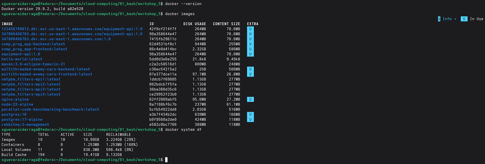

## Parte 3. Descarga de imágenes
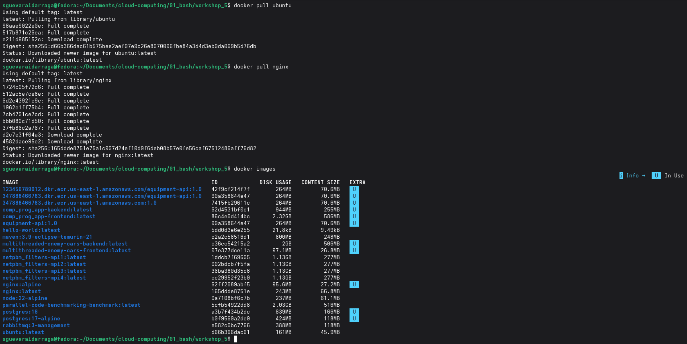

## Parte 4. Primer contenedor
Entré al contenedor Ubuntu en modo interactivo y ejecuté `pwd`, `ls` y `whoami`. Dentro soy `root` y estoy en la raíz `/`.

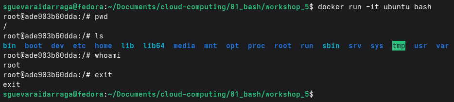

## Parte 5. Contenedor web
Levanté Nginx en segundo plano publicando el puerto 8080. Como la evidencia es por terminal, comprobé el acceso con `curl` a `http://localhost:8080`, que devuelve la página de bienvenida de Nginx.

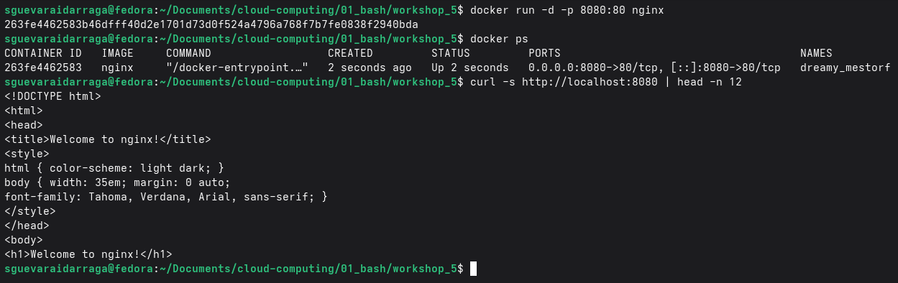

## Parte 6. Administración
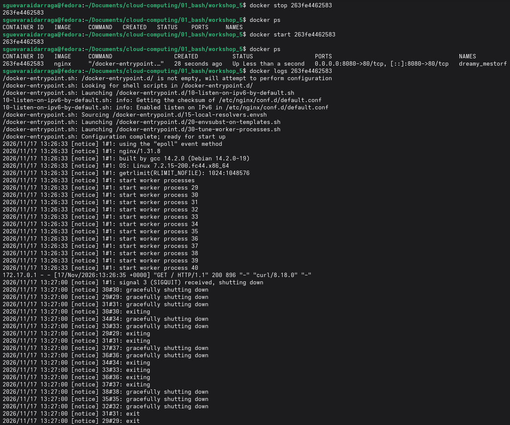
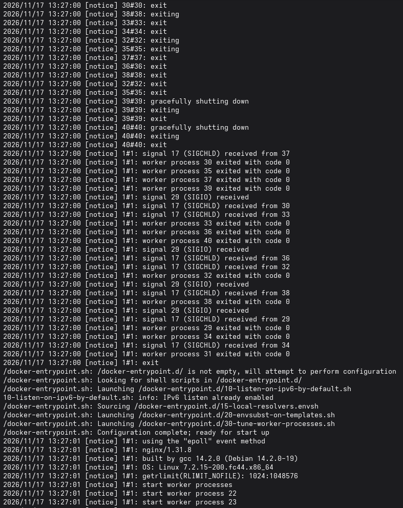
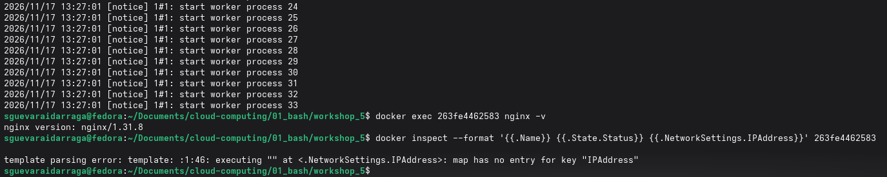

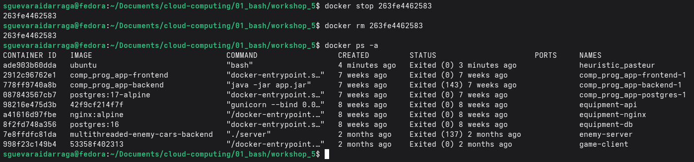

| Comando | Qué hace |
|---|---|
| `docker stop` | Detiene un contenedor que está corriendo |
| `docker start` | Vuelve a iniciar un contenedor que estaba detenido |
| `docker logs` | Muestra los registros que genera el contenedor |
| `docker exec` | Ejecuta un comando dentro de un contenedor que está corriendo |
| `docker inspect` | Muestra información detallada del contenedor o la imagen en formato JSON |
| `docker rm` | Elimina un contenedor que está detenido |
| `docker rmi` | Elimina una imagen del equipo |

## Parte 7. Recursos Docker
Para `docker system prune` respondí que no (`n`) cuando pidió confirmación, para no borrar recursos sin necesidad.

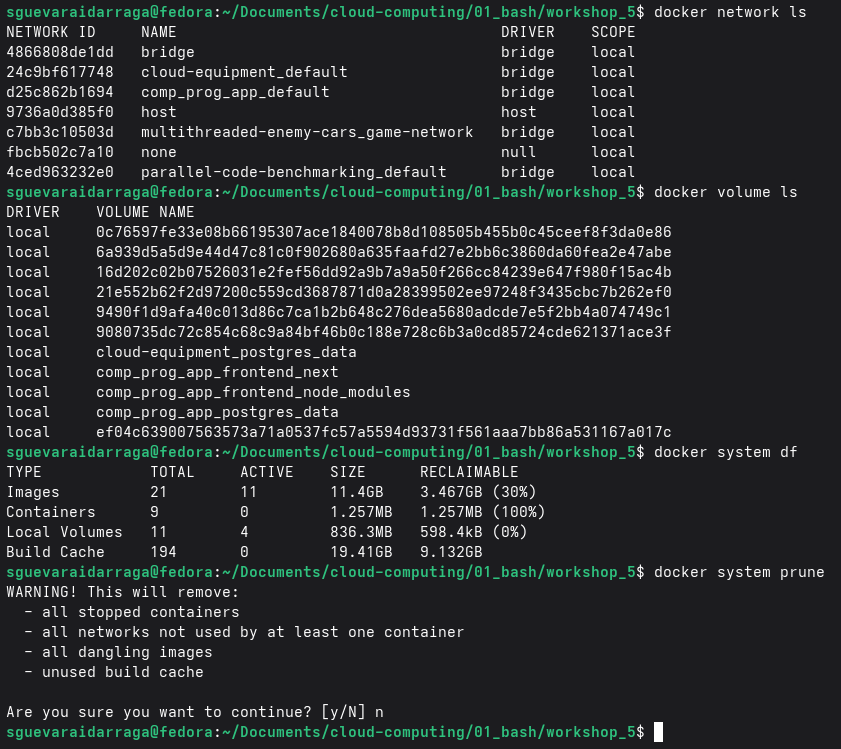

| Comando | Recurso que administra |
|---|---|
| `docker network ls` | Redes que Docker usa para comunicar contenedores |
| `docker volume ls` | Volúmenes donde se guardan datos que deben persistir |
| `docker system df` | Espacio en disco que usan imágenes, contenedores y volúmenes |
| `docker system prune` | Limpia contenedores detenidos, redes sin uso e imágenes huérfanas |

## Reto integrador
Creé un contenedor Ubuntu (`ubuntu-reto`) y uno Nginx (`nginx-reto`), entré al de Ubuntu con `docker exec` y consulté los logs del de Nginx.

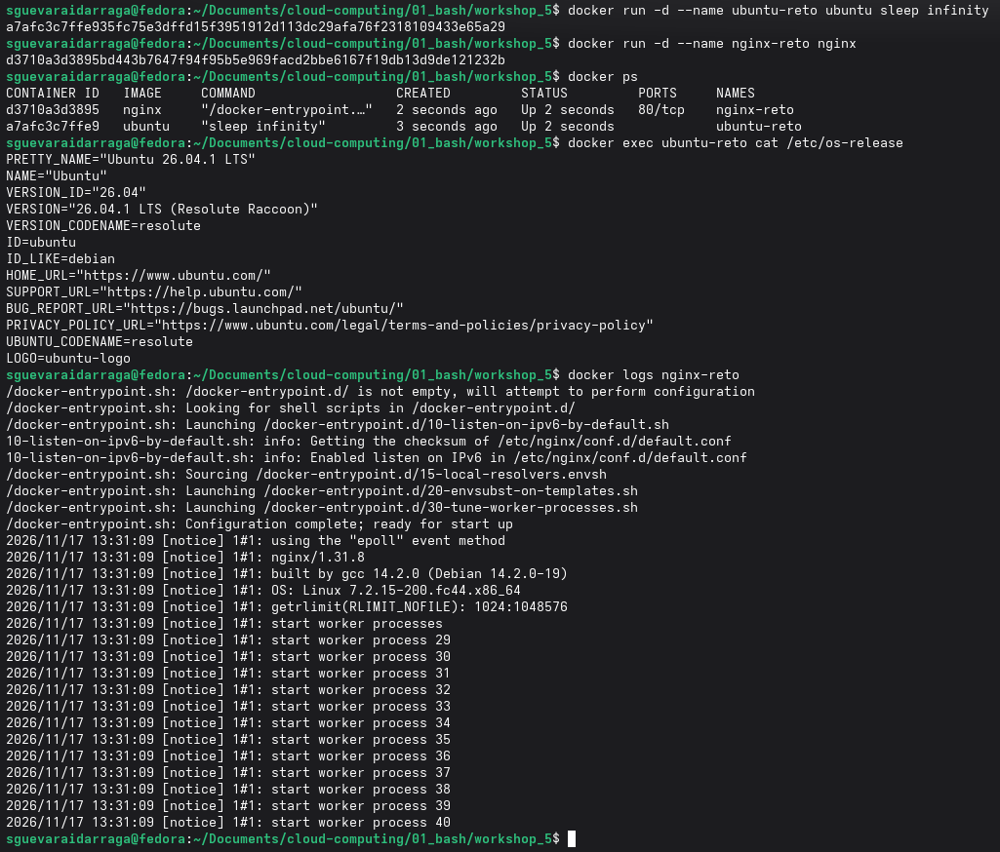

Después detuve los dos contenedores, los eliminé y borré las imágenes descargadas.

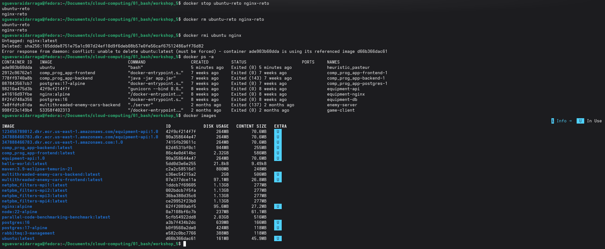

| Comando | Propósito |
|---|---|
| `docker run -d --name ubuntu-reto ubuntu sleep infinity` | Crea un contenedor Ubuntu que se mantiene corriendo |
| `docker run -d --name nginx-reto nginx` | Crea el contenedor Nginx en segundo plano |
| `docker ps` | Confirma que ambos están activos |
| `docker exec ubuntu-reto cat /etc/os-release` | Ejecuta un comando dentro del contenedor Ubuntu |
| `docker logs nginx-reto` | Consulta los registros de Nginx |
| `docker stop` | Detiene ambos contenedores |
| `docker rm` | Elimina ambos contenedores |
| `docker rmi ubuntu nginx` | Elimina las imágenes descargadas |

## Preguntas de reflexión
1. La imagen es la plantilla de solo lectura con la aplicación y sus dependencias. El contenedor es una instancia en ejecución de esa imagen. De una misma imagen puedo crear varios contenedores.
2. Porque la imagen contiene todo lo que la aplicación necesita, así que funciona igual en mi equipo, en un servidor o en la nube. Eso hace los despliegues más rápidos, repetibles y fáciles de escalar.
3. No ensucia el sistema operativo con dependencias, evita conflictos entre versiones, aísla cada aplicación y permite instalar o eliminar todo en segundos.
4. Cuando los datos deben sobrevivir al contenedor, por ejemplo la base de datos de PostgreSQL o archivos subidos por usuarios. También para compartir datos entre contenedores.
5. Puede borrar contenedores detenidos, imágenes y redes que se necesitaban, por ejemplo un contenedor que se detuvo temporalmente. En producción eso puede causar caídas o pérdida de datos, por lo que se debe revisar antes qué se va a eliminar.
