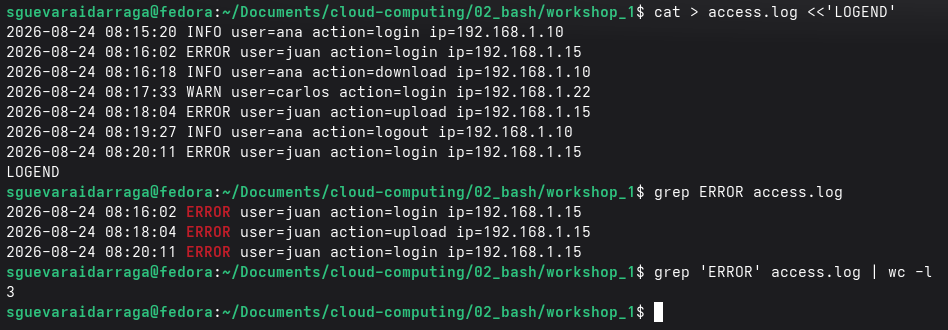
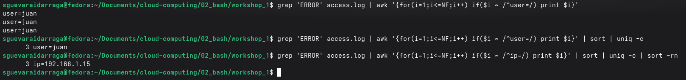
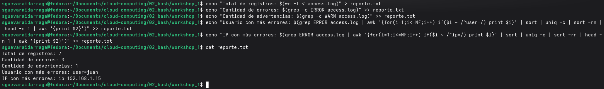
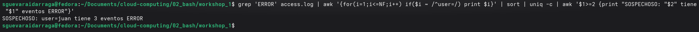
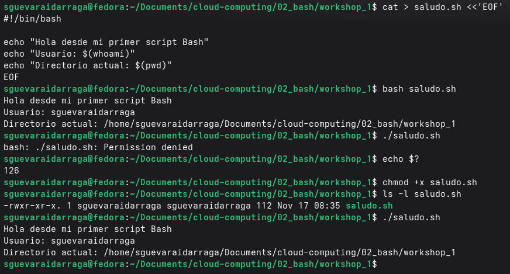
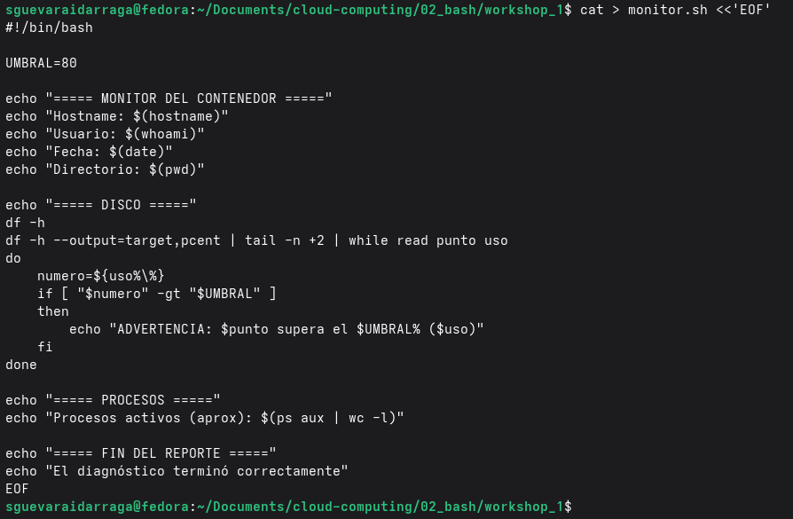
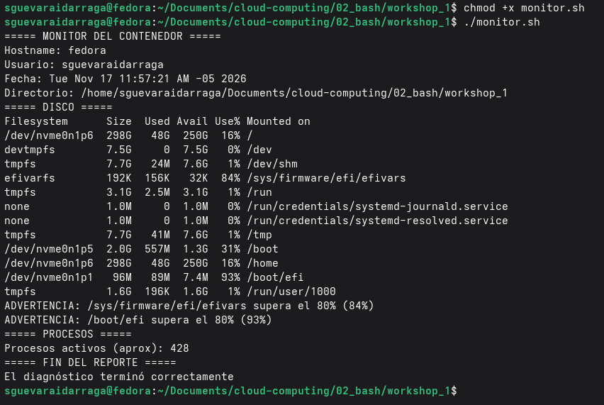
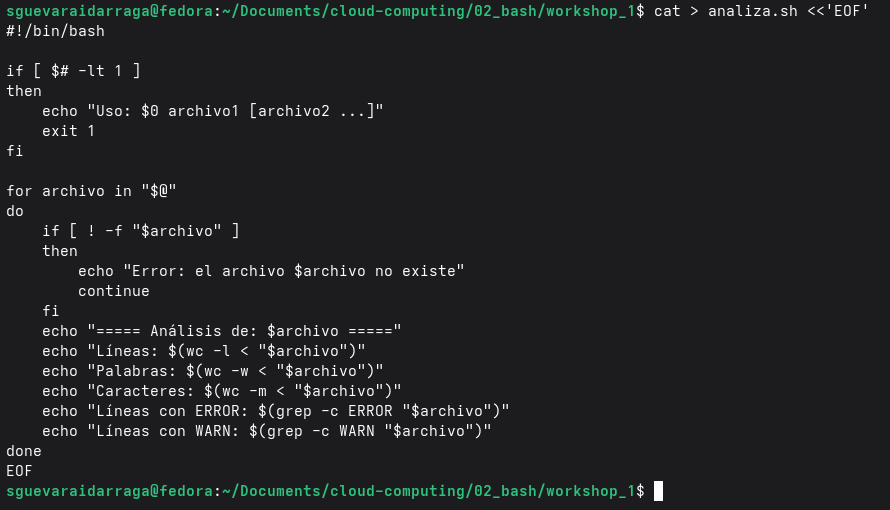
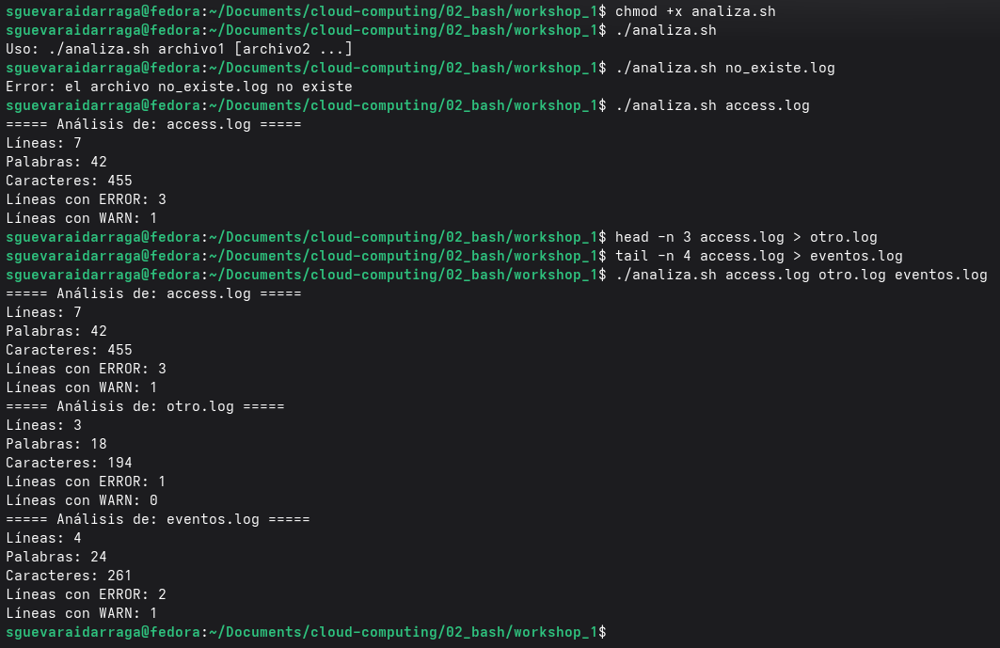

# Taller 1 - Bash avanzado y scripts

## Parte 1. Análisis de logs
Creé el archivo `access.log` y resolví los puntos A y B (detectar y contar errores).

Puntos C, D y E. Usuarios con error, errores por usuario e IP más asociada a errores.

Punto F. Generé `reporte.txt` con pipes y redirecciones.

**Desafío.** Agrupé los errores por usuario y mostré una alerta cuando alguno tiene dos o más. El usuario `juan` tiene 3 eventos ERROR, así que se marca como sospechoso.

## Parte 2. Ejecutar archivos Bash

**Preguntas**
1. `#!/bin/bash` es el shebang. Le indica al sistema qué intérprete debe usar para ejecutar el archivo, en este caso Bash.
2. Con `bash saludo.sh` le digo a Bash que lea y ejecute el archivo, por lo que no necesita permiso de ejecución. Con `./saludo.sh` el sistema ejecuta el archivo directamente, por lo que sí necesita ese permiso y usa el shebang para saber con qué intérprete correrlo.
3. Si el archivo no tiene permiso de ejecución, `./saludo.sh` falla con el mensaje `Permission denied` y devuelve el código 126, como se ve en la captura.
4. `$?` devuelve el código de salida del último comando. Un `0` significa que terminó bien y un valor distinto indica un error.

## Parte 3. Script sin argumentos: monitor.sh
Script:

Ejecución. Incluí la extensión que muestra una advertencia si una partición supera el 80 % de uso.

## Parte 4. Script con argumentos: analiza.sh
Script:

Pruebas sin argumentos, con un archivo inexistente, con un archivo válido y con varios archivos a la vez (extensión avanzada).

