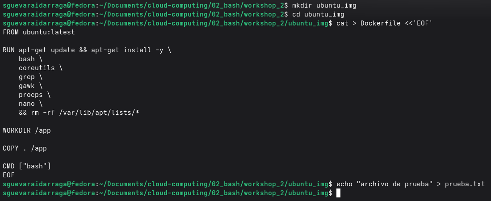
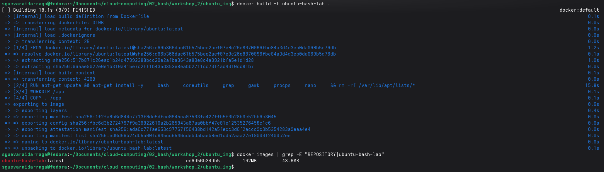
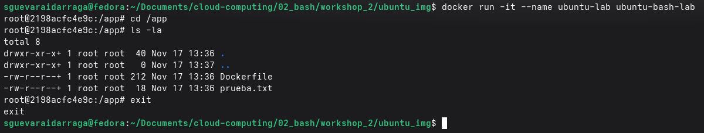
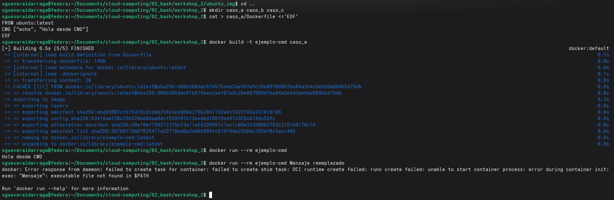
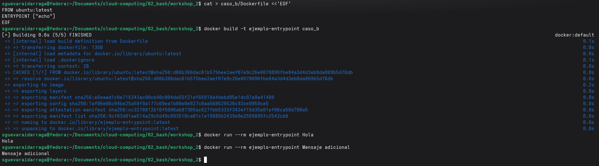
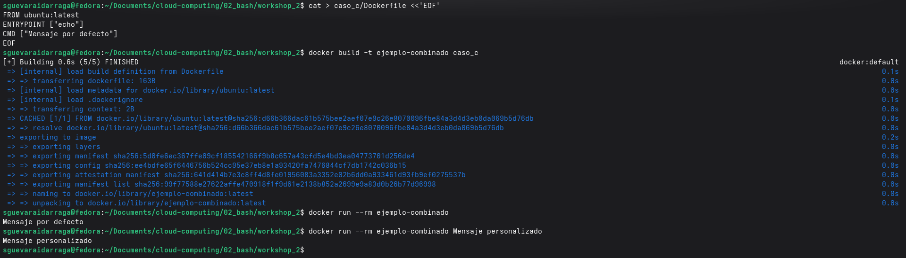

# Taller 2 - Construcción de imágenes con Dockerfile

## Parte 1. Imagen Ubuntu para el laboratorio
Dockerfile:

Construcción de la imagen `ubuntu-bash-lab`:

Ejecución del contenedor y revisión de `/app`. Se ve el archivo `prueba.txt` y el `Dockerfile` copiados con `COPY . /app`.

## Parte 2. CMD vs ENTRYPOINT

**Caso A. Solo CMD.** Sin argumentos imprime el mensaje por defecto. Al pasar `"Mensaje reemplazado"` el `CMD` se reemplaza por completo, entonces Docker intenta ejecutar ese texto como si fuera un programa y falla porque no existe.

**Caso B. Solo ENTRYPOINT.** El programa `echo` queda fijo y lo que escribo al final de `docker run` se agrega como argumento. Por eso imprime "Hola" y luego "Mensaje adicional".

**Caso C. ENTRYPOINT + CMD.** Sin argumentos imprime el mensaje por defecto. Con un argumento, solo se reemplaza el `CMD` y el `ENTRYPOINT` se mantiene.

| Caso | Instrucciones | Sin argumentos | Con argumentos |
|---|---|---|---|
| A | CMD | Ejecuta el comando por defecto | Reemplaza todo el comando y falla si no es un programa válido |
| B | ENTRYPOINT | Ejecuta `echo` sin texto | Los argumentos se agregan a `echo` |
| C | ENTRYPOINT + CMD | Usa el mensaje por defecto | Reemplaza solo el mensaje por defecto |

## Preguntas de análisis
1. `CMD` es la que se comporta como valor por defecto, porque se puede reemplazar al ejecutar el contenedor.
2. `ENTRYPOINT` define el programa principal del contenedor.
3. Cuando se pasa un comando al final de `docker run`, el `CMD` se reemplaza por ese comando.
4. Porque el contenedor siempre ejecuta el mismo programa y el usuario solo cambia los argumentos. Así el contenedor funciona como una herramienta concreta, por ejemplo un conversor o un cliente de línea de comandos.
5. Usaría `ENTRYPOINT` para el ejecutable fijo y `CMD` para los parámetros por defecto que se puedan modificar al correr el contenedor.
