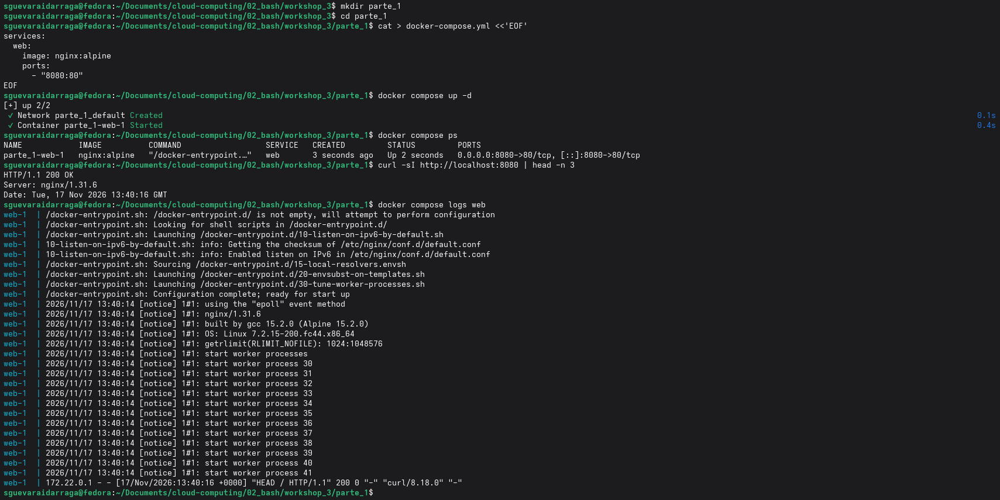
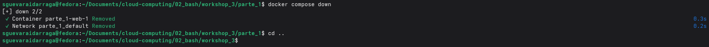
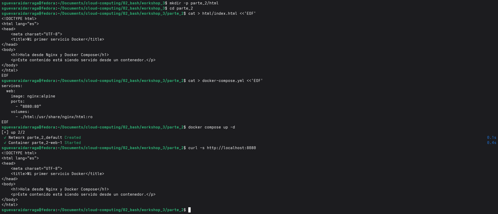
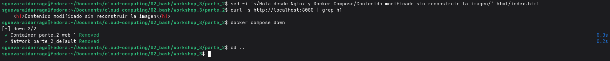
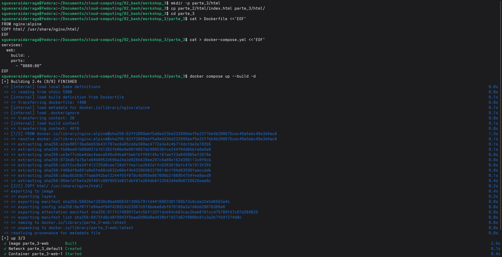
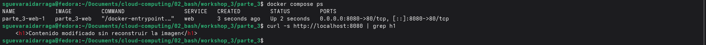
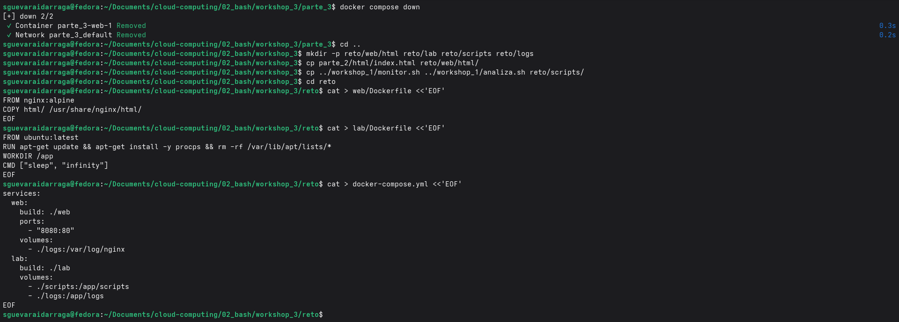
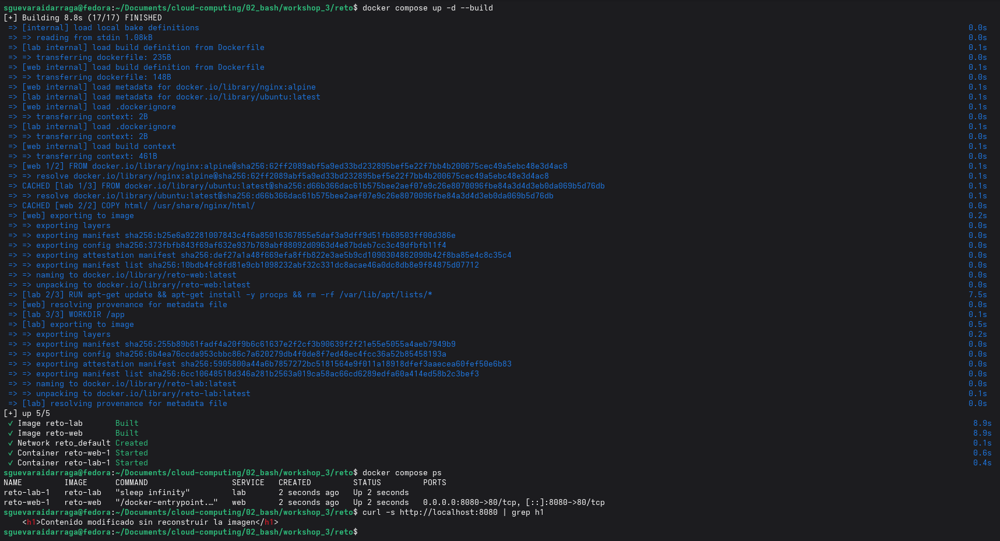
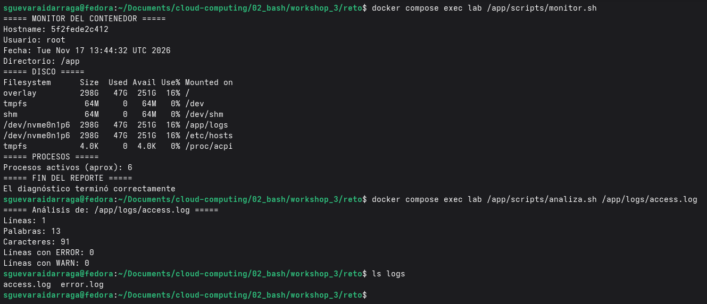

# Taller 3 - Docker Compose y Nginx

## Parte 1. Primer servicio Nginx
Creé el `docker-compose.yml`, levanté el servicio, verifiqué el estado con `docker compose ps`, hice una petición a `localhost:8080` y consulté los logs.

Al final detuve el servicio con `docker compose down`.

## Parte 2. Nginx con contenido propio
Creé `html/index.html` y monté la carpeta como volumen. La respuesta de `localhost:8080` muestra mi página.

Después modifiqué `index.html` y el cambio apareció de inmediato sin reconstruir nada.

**Preguntas**
1. Porque la carpeta `html` del host está montada dentro del contenedor. Nginx lee directamente esos archivos, así que cualquier cambio se ve al instante y no hace falta reconstruir la imagen.
2. `:ro` significa read-only. El contenedor puede leer los archivos pero no modificarlos.
3. El puerto `8080` es el del equipo anfitrión, por donde accedo desde el navegador. El puerto `80` es el que Nginx usa dentro del contenedor. Docker conecta uno con el otro.
4. En `8080:80` la parte izquierda (`8080`) es el host y la parte derecha (`80`) es el contenedor.

## Parte 3. Compose con Dockerfile
Esta vez la página queda copiada dentro de la imagen con `COPY` y Compose construye la imagen con `build: .`.

## Parte 4. Reto integrador
Estructura del proyecto con dos servicios, `web` (Nginx) y `lab` (Ubuntu con Bash y `procps`). Los scripts `monitor.sh` y `analiza.sh` se comparten con el contenedor Ubuntu y la carpeta `logs` es un volumen compartido entre los dos servicios.

Los dos servicios están corriendo al mismo tiempo y Nginx responde en `localhost:8080`.

Ejecución de los scripts dentro del contenedor Ubuntu. El script `analiza.sh` lee el `access.log` que Nginx escribe en la carpeta compartida.

**Pregunta de diseño.** Docker Compose es más conveniente porque toda la configuración queda en un solo archivo que se puede versionar y repetir. Con un comando levanto o detengo todos los servicios, con sus puertos, volúmenes y redes ya definidos. Con varios `docker run` tendría que escribir cada comando largo a mano, recordar el orden y las opciones, y es mucho más fácil equivocarse.
