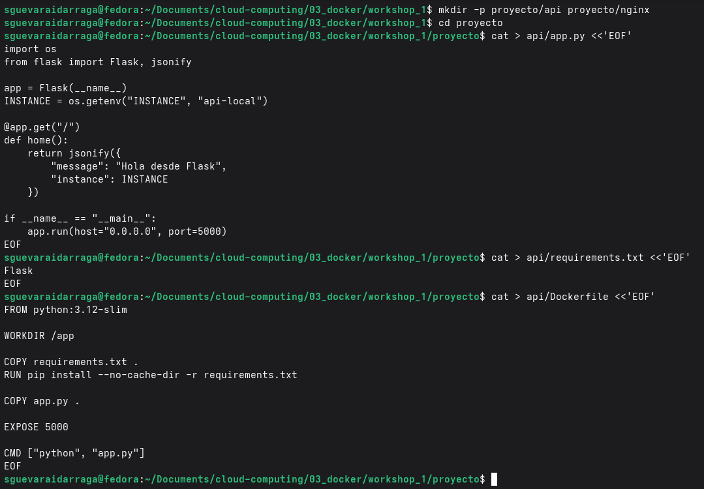
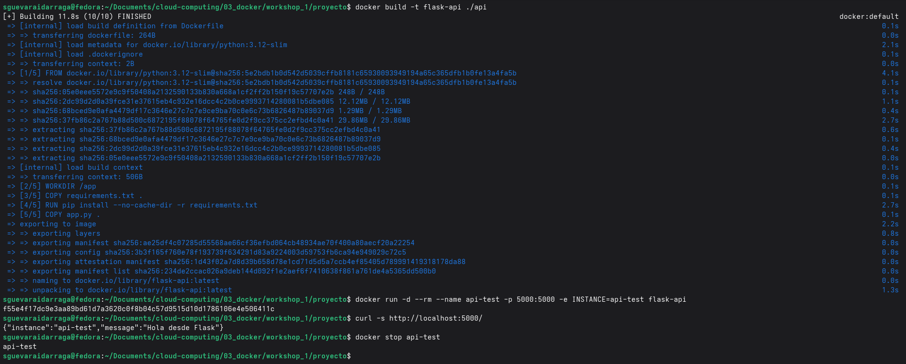
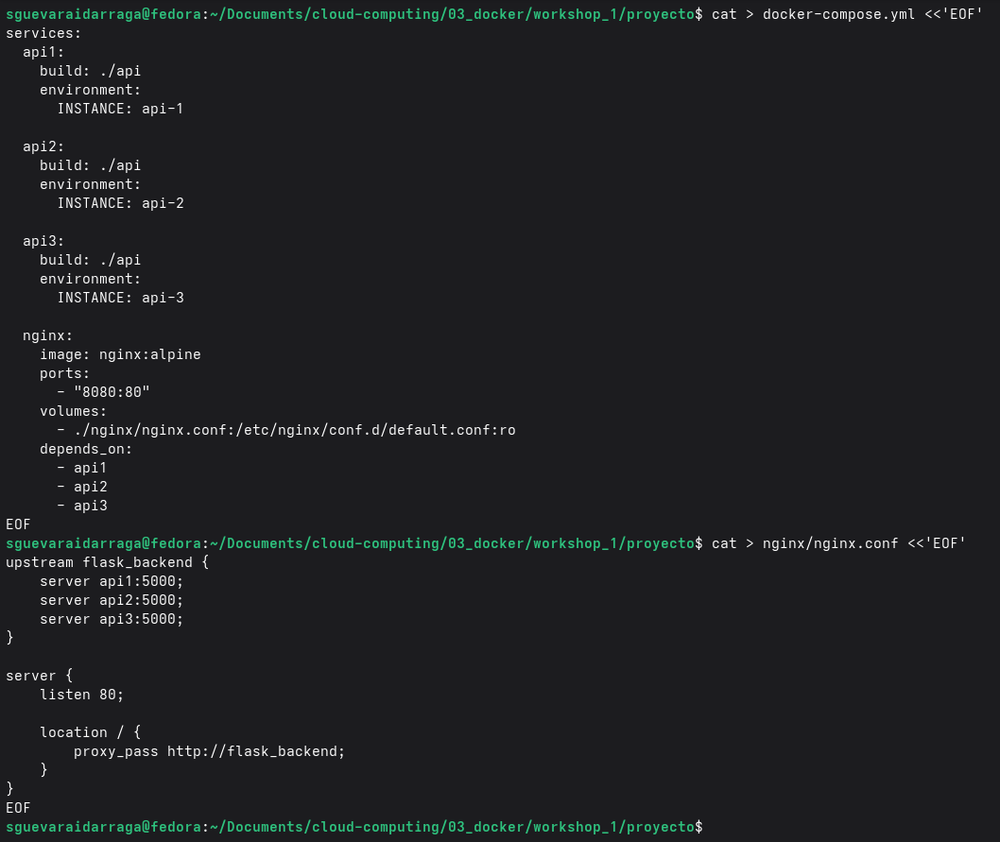
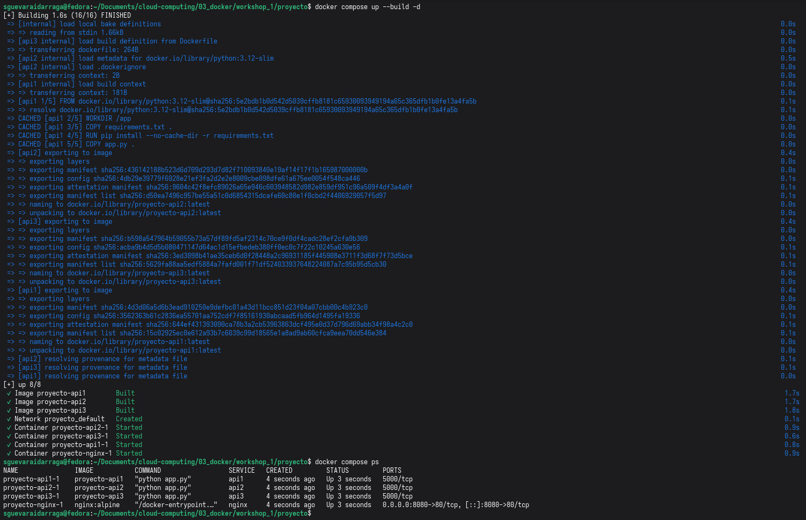
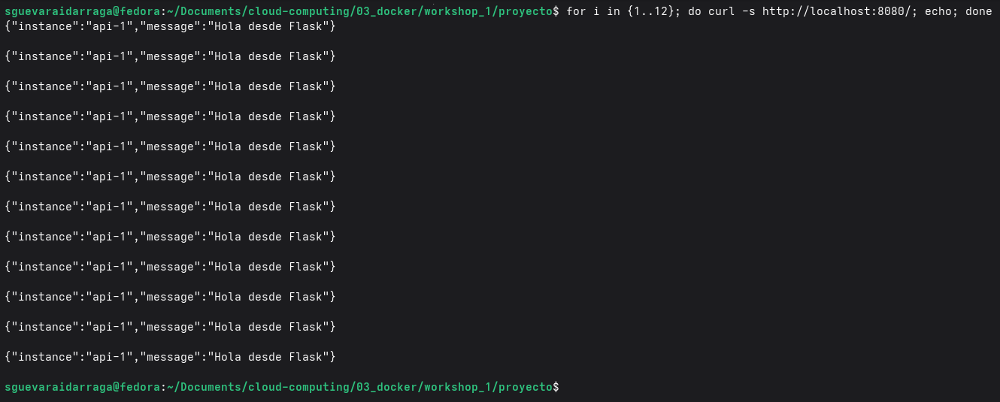
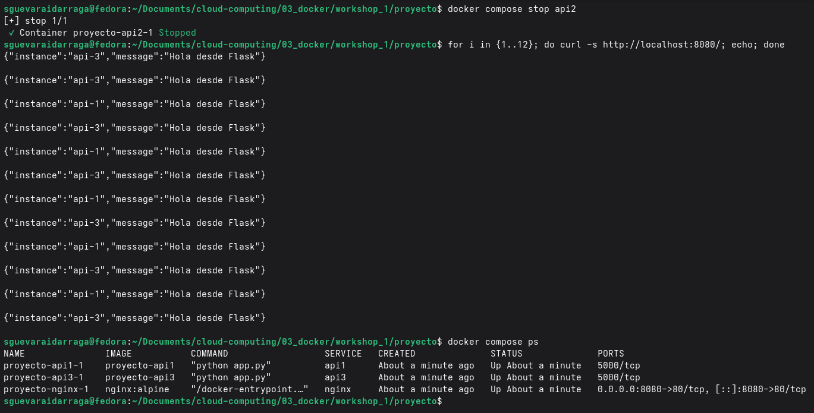
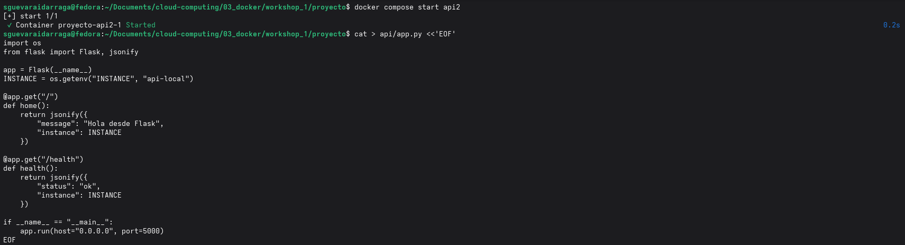
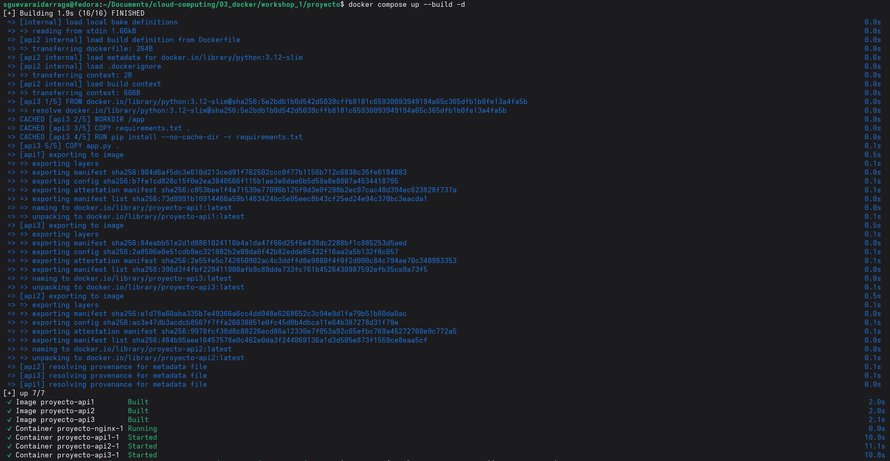
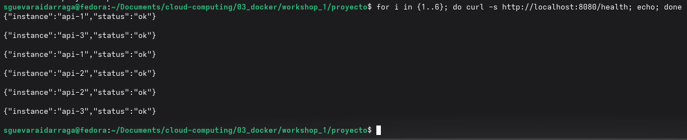

# Taller 1 - API Flask y Balanceamiento de Carga con Nginx

## Partes 1 y 2. API Flask, requirements y Dockerfile

Construí la imagen y la probé sola, antes de crear el balanceamiento. Responde con la instancia `api-test`.

## Partes 3 y 4. Docker Compose y Nginx
Tres instancias de la misma imagen (`api1`, `api2`, `api3`) y Nginx con un `upstream` que las agrupa.

## Parte 5. Evidenciar el balanceamiento

Con 12 peticiones al puerto 8080 las respuestas rotan entre `api-1`, `api-2` y `api-3`, cuatro veces cada una.

Al detener `api2`, las peticiones siguen respondiendo pero ahora solo aparecen `api-1` y `api-3`. Es posible que alguna petición tarde un poco porque Nginx intenta primero con la instancia caída y luego pasa a la siguiente.

## Reto. Endpoint /health
Agregué `/health` a la API, reconstruí y probé varias veces a través de Nginx.

Investigación: un health check es una ruta liviana que el balanceador o el orquestador consulta cada cierto tiempo. Si una instancia no responde `ok`, se deja de enviarle tráfico o se reinicia. Así se evita mandar usuarios a instancias dañadas. En AWS lo usan el Load Balancer y Auto Scaling, y en Docker Compose se puede usar `healthcheck`.

## Preguntas de análisis
1. Porque el único contenedor que publica un puerto es Nginx. Las APIs viven en la red interna de Docker y el cliente no sabe cuántas hay ni cómo se llaman.
2. `upstream` define el grupo de servidores backend entre los que Nginx reparte las peticiones.
3. Round Robin. Envía cada petición a la siguiente instancia de la lista, en orden y de forma cíclica.
4. Nginx deja de usar esa instancia y reparte entre las demás. El servicio sigue funcionando, solo con menos capacidad.
5. Nginx, porque todo el tráfico pasa por él. Si falla, nadie puede llegar a las APIs aunque estén sanas.
6. Porque para soportar más carga agrego más instancias iguales y no una máquina más grande.
7. Agregar los servicios `api4` y `api5` en el `docker-compose.yml`, con su variable `INSTANCE`, y sumarlos al `upstream` y al `depends_on` de Nginx.
