# Taller 2 - Reverse Proxy con Nginx

## Parte 1. Dos APIs
Creé los servicios `users` y `products`. Agregué el campo `instance` para poder identificar quién responde cuando haya varias instancias.

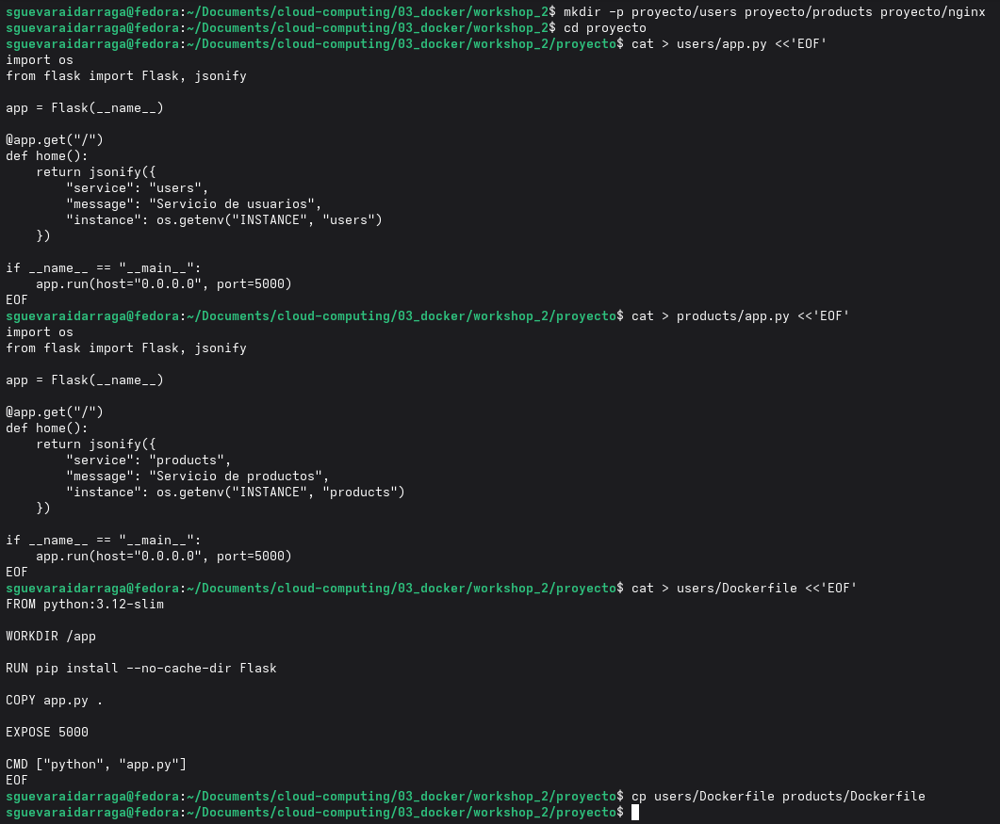

## Partes 2 y 3. Compose y Reverse Proxy
Los servicios Flask no publican puertos. Solo Nginx expone el 8080.

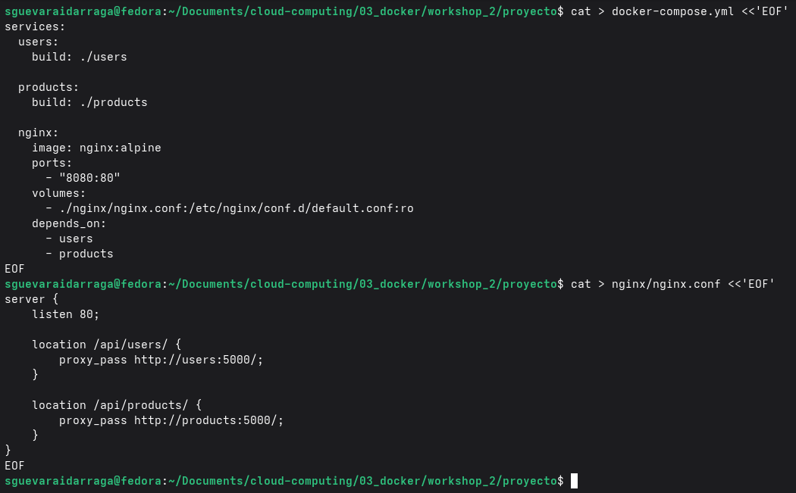

Cada ruta llega a su servicio.

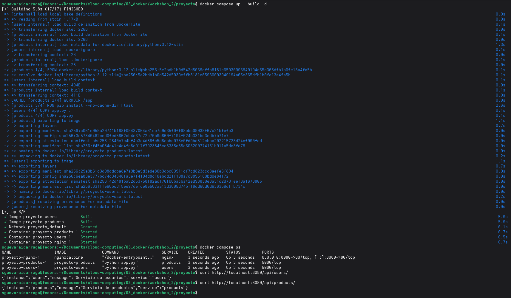

## Parte 4. Analizar la diferencia
Seis peticiones a `/api/users/` responden siempre con la misma instancia. Cada ruta va a un backend específico y no hay distribución entre varias copias. Lo que se observa es reverse proxy con routing, no balanceamiento.

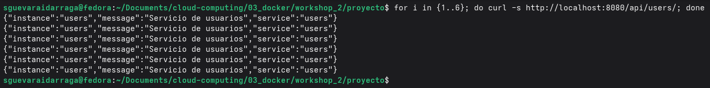

## Parte 5. Reverse Proxy + Load Balancer
Cambié `users` por `users1` y `users2` y agregué un `upstream` en Nginx.

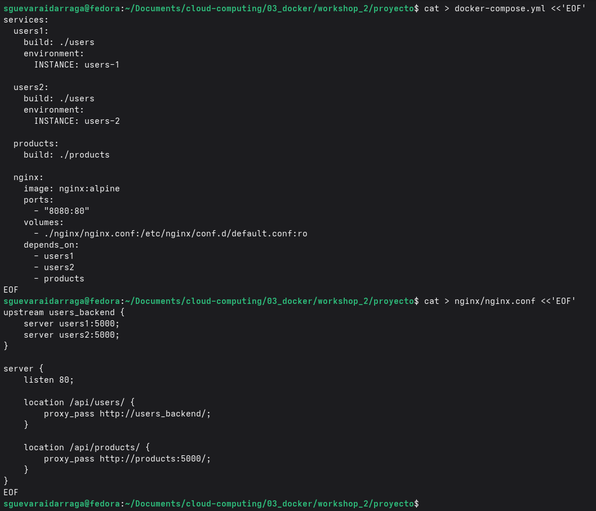

Ahora las peticiones a `/api/users/` alternan entre `users-1` y `users-2`, mientras que `/api/products/` sigue respondiendo siempre desde el mismo servicio.

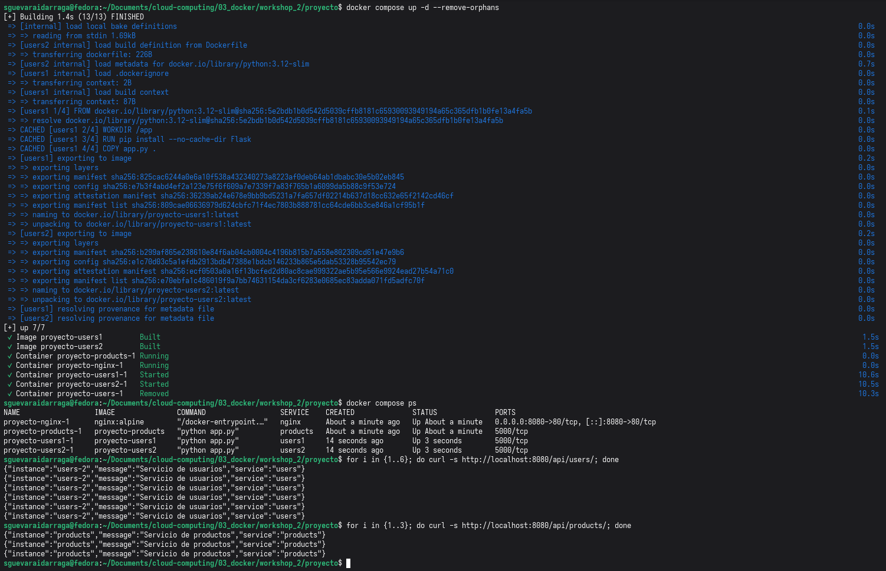

## Reto. /api/orders/
Creé el servicio `orders` con dos instancias balanceadas.

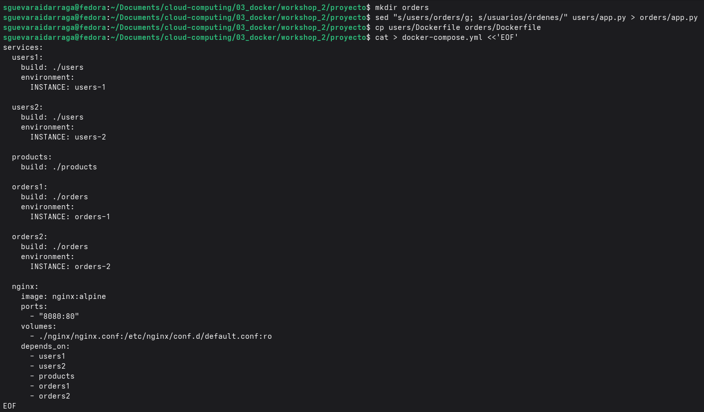
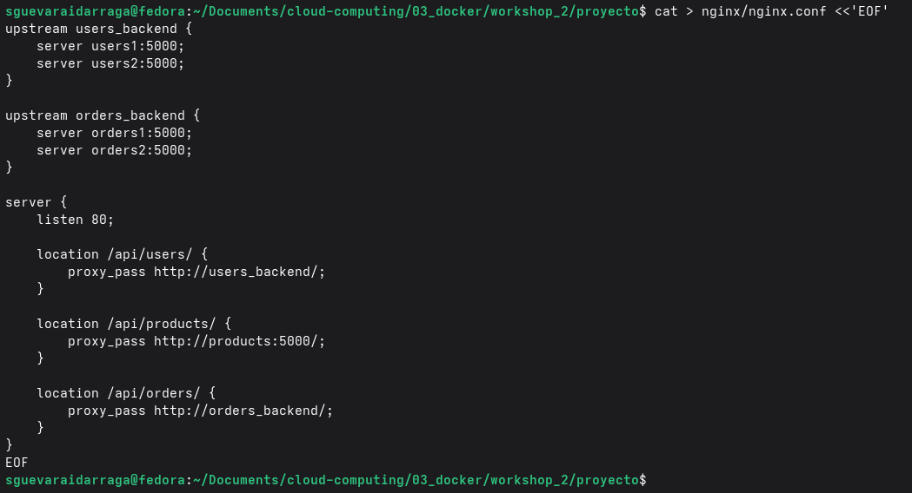

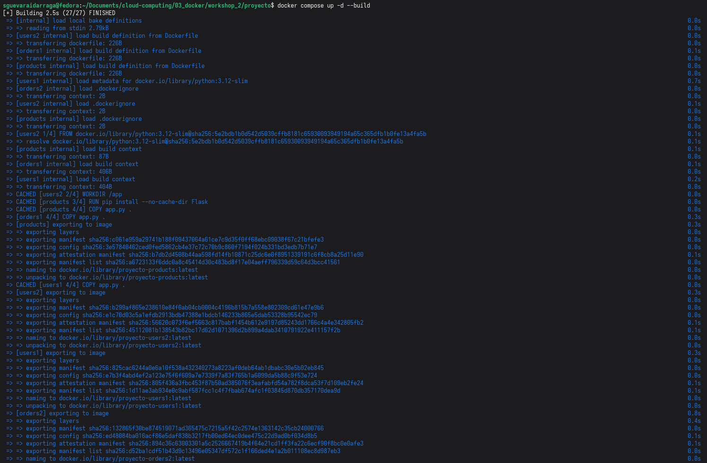
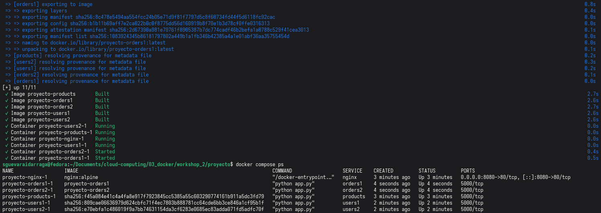
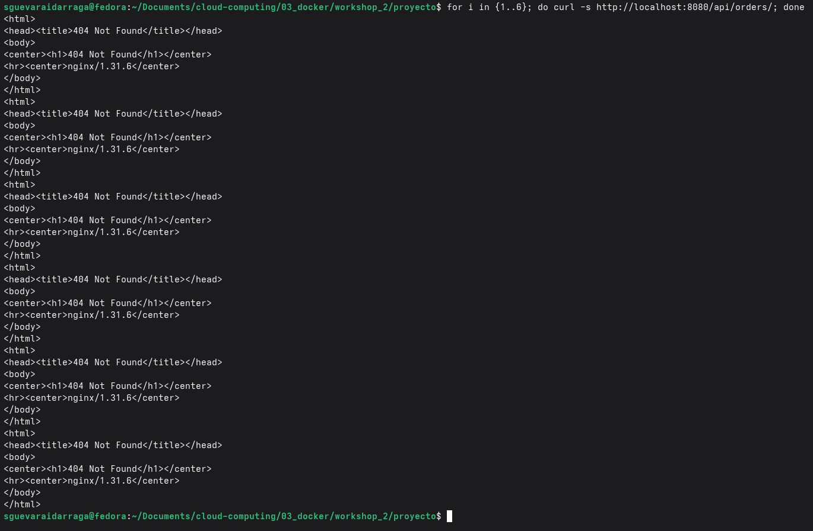

## Diferencia entre ambos escenarios
- **Reverse proxy con routing:** Nginx recibe todo en un solo punto y decide a qué servicio enviarlo según la ruta. Cada ruta tiene un único backend y no mejora la capacidad.
- **Reverse proxy con load balancing:** además de enrutar por ruta, Nginx reparte las peticiones de una misma ruta entre varias instancias iguales con un `upstream`. Así se gana capacidad y tolerancia a fallos.

Un reverse proxy no implica balanceamiento. Se puede tener uno sin el otro, aunque Nginx hace las dos cosas.
