# Taller 3 - Tres APIs Flask balanceadas con PostgreSQL

## Parte 1. PostgreSQL
Script SQL con la tabla `products` y seis productos. Se carga automáticamente al crear el contenedor.

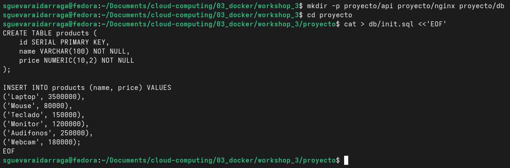

## Partes 2 y 3. Flask con PostgreSQL y variables de entorno
La API lee `INSTANCE`, `DB_HOST`, `DB_NAME`, `DB_USER` y `DB_PASSWORD` desde variables de entorno. No hay credenciales escritas en el código.

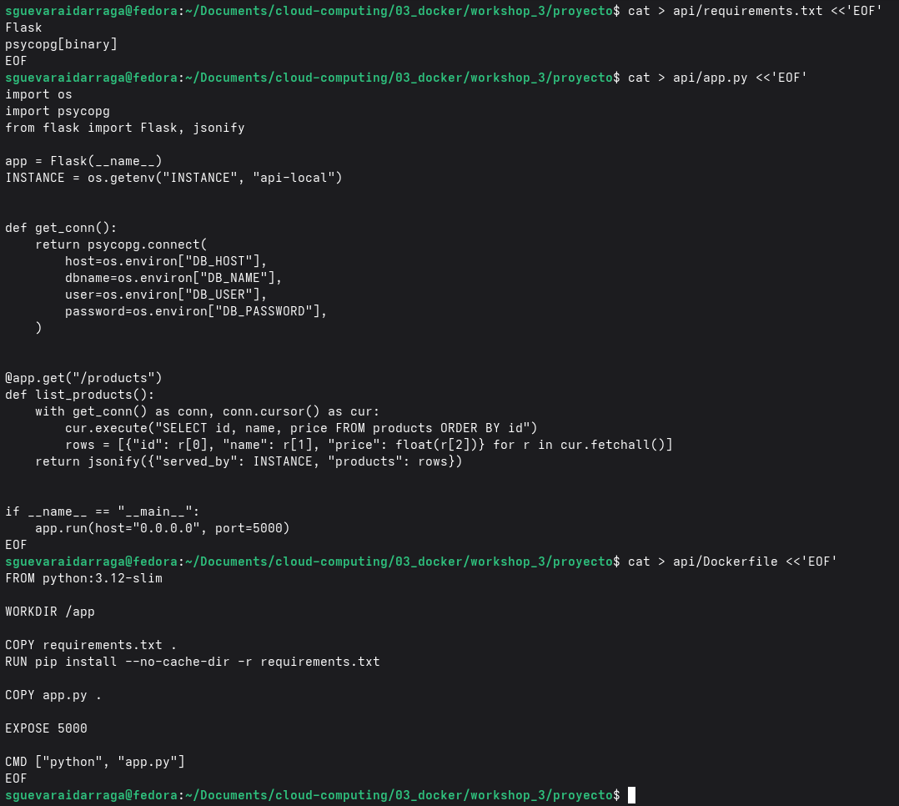

## Parte 4. Tres APIs y Nginx
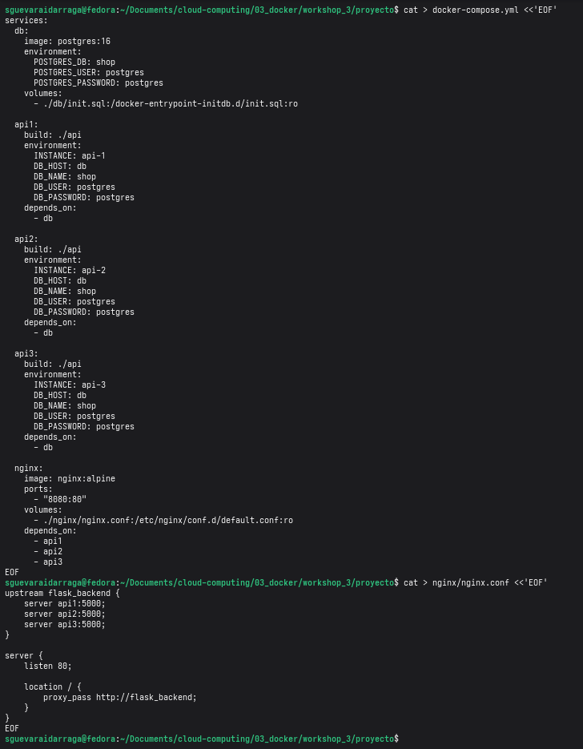

## Parte 5. Prueba de integración
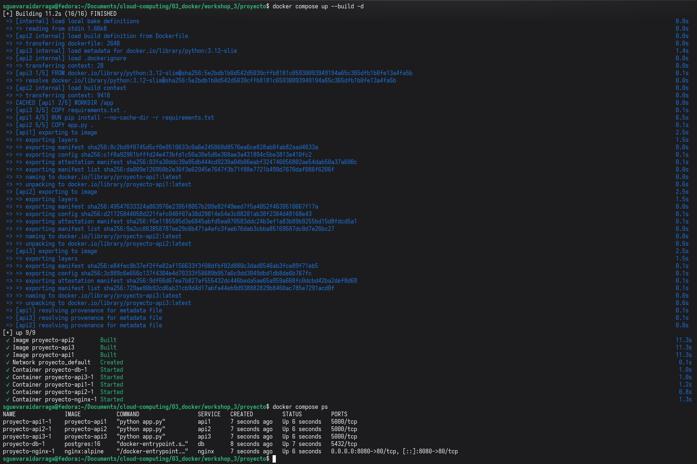

En las 15 peticiones cambia `served_by` entre `api-1`, `api-2` y `api-3`, pero la lista de productos es la misma en todas. Las tres APIs consultan el mismo PostgreSQL.

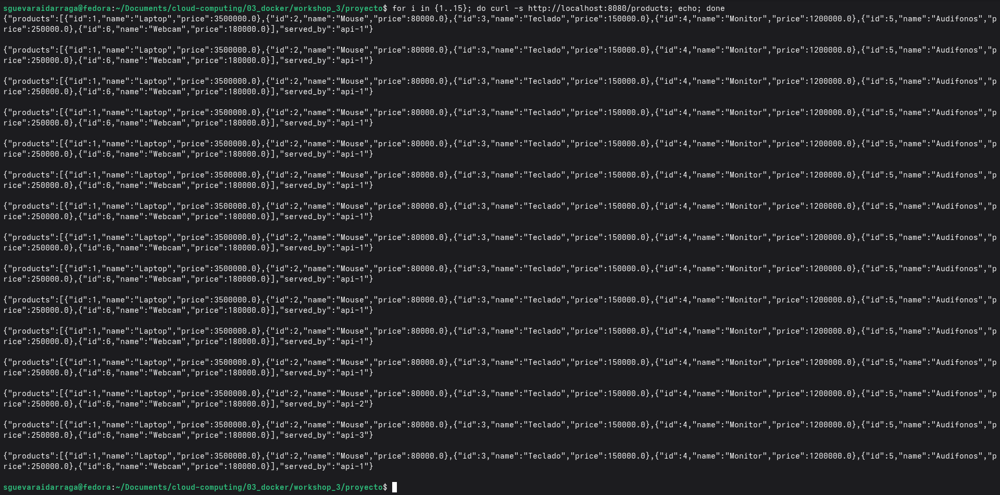

Consulta directa a la base de datos para confirmar que los datos son los mismos.

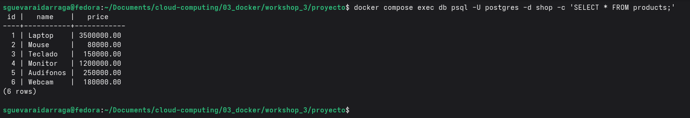

## Parte 6. Tolerancia ante fallo
Con `api2` detenida el servicio sigue respondiendo con `api-1` y `api-3`.

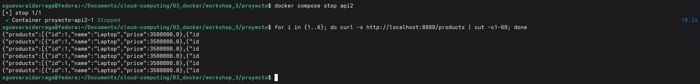

Con dos APIs detenidas todo el tráfico llega a `api-1`. Sigue funcionando, pero con una sola instancia. Si se detienen las tres, Nginx responde con error 502.

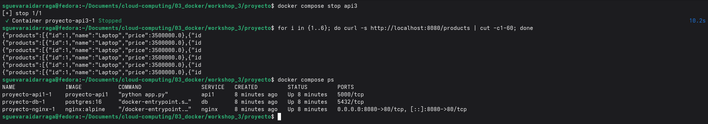

## Parte 7. Reto CRUD
Agregué `GET /products/<id>`, `POST`, `PUT` y `DELETE`.

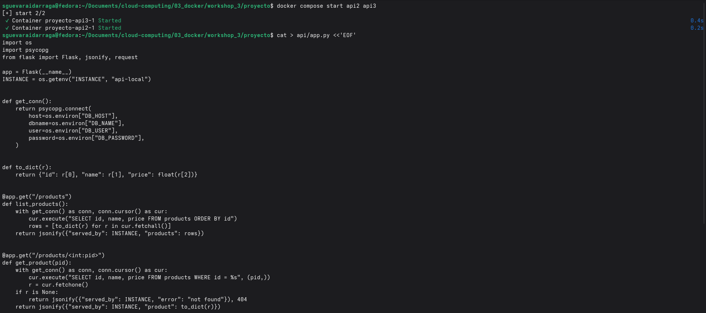
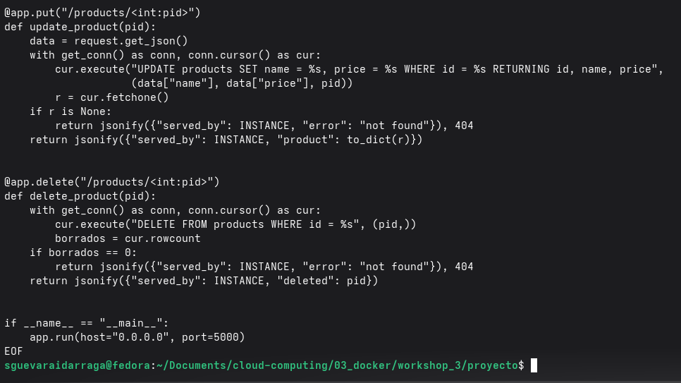

Creé el producto 7 y lo consulté varias veces. Responden distintas instancias con el mismo dato, lo que demuestra que un registro creado desde una instancia se puede leer desde otra.

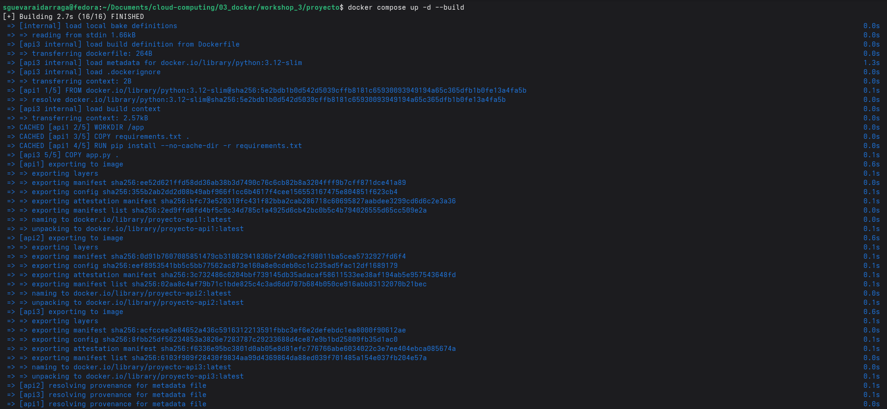
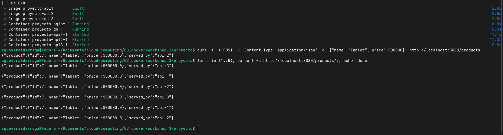

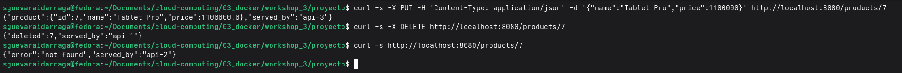

## Análisis
1. En PostgreSQL. Las APIs no guardan nada importante en memoria ni en disco.
2. Porque no guardan estado propio. Cada petición trae lo necesario y los datos se consultan en la base, así que cualquier instancia puede atender cualquier petición.
3. No pasa nada grave. El estado está en la base, así que al reiniciar la API sigue con los mismos datos. Mientras tanto Nginx envía el tráfico a las otras instancias.
4. Las APIs pierden la conexión y devuelven error hasta que la base vuelva. Los datos no se pierden si el volumen persiste. En este taller no monté un volumen, entonces si se elimina el contenedor se reinicia con los datos del script SQL.
5. Nginx y PostgreSQL. Ambos son una sola instancia y si cualquiera cae, el sistema deja de responder.
6. No. Balancear las APIs escala la capa de aplicación, pero todas siguen apuntando a una sola base de datos, que puede convertirse en el cuello de botella.
7. Réplicas de lectura o un clúster de base de datos, un balanceador redundante, volúmenes o almacenamiento administrado, health checks, copias de seguridad, monitoreo y secretos en un servicio seguro en lugar de texto plano.
