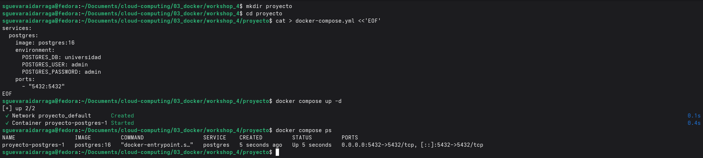
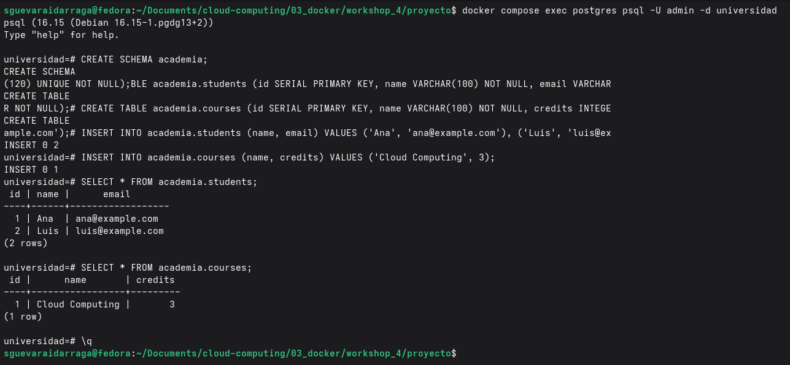
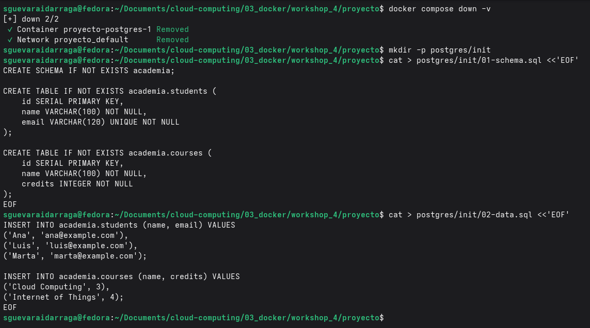
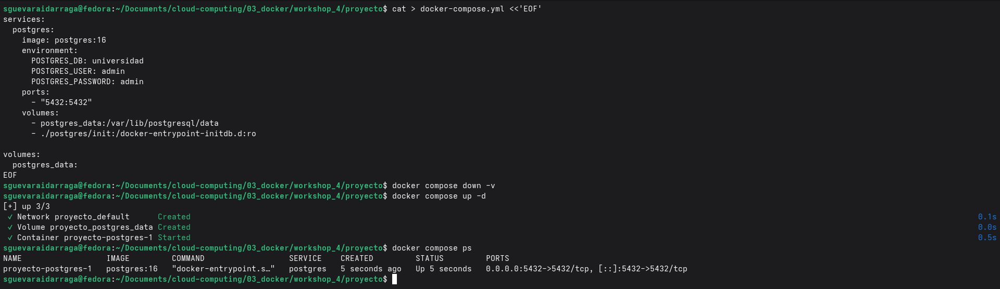
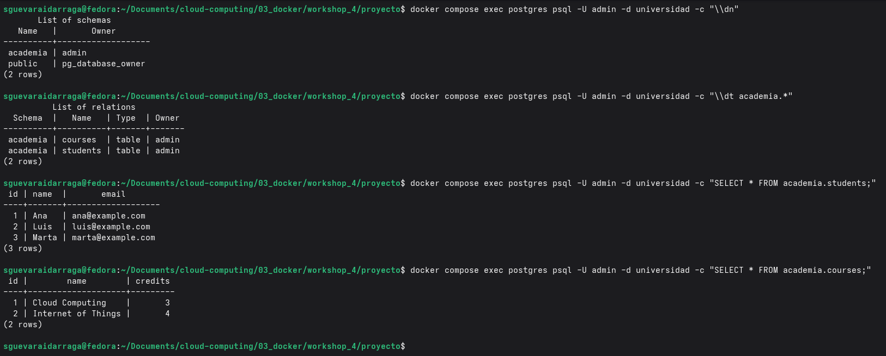
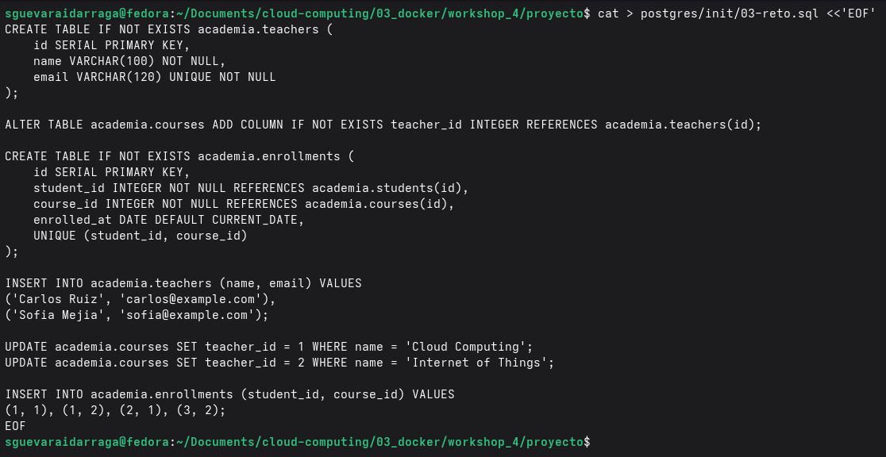
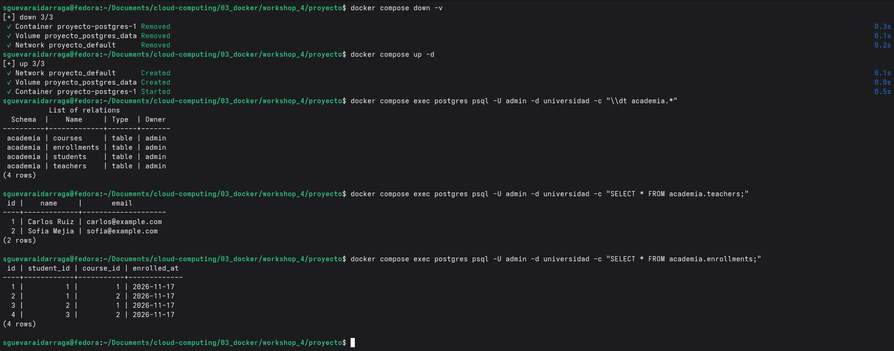
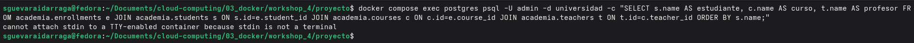

# Taller 4 - PostgreSQL con Docker y Docker Compose

## Parte 1. Construcción manual

## Parte 2. Crear la estructura a mano con psql
Entré con `psql`, creé el esquema `academia`, las tablas `students` y `courses`, inserté datos y los consulté.

Después eliminé todo con `docker compose down -v` para probar la automatización desde cero.

## Parte 3. Scripts de inicialización

## Parte 4. Montar los scripts y el volumen

## Parte 5. Verificación de la carga automática
Después de `docker compose down -v` y `docker compose up -d`, el esquema, las tablas y los datos aparecen solos. La carpeta `/docker-entrypoint-initdb.d` solo se ejecuta cuando el directorio de datos está vacío, por eso hay que borrar el volumen con `-v` para repetir la prueba.

## Parte 6. Reto
Agregué el script `03-reto.sql` con `teachers` y `enrollments`, las llaves foráneas y datos de prueba.

Eliminé el volumen y volví a levantar. Todo se reconstruyó automáticamente.

Consulta que une las cuatro tablas para comprobar que las relaciones funcionan.

