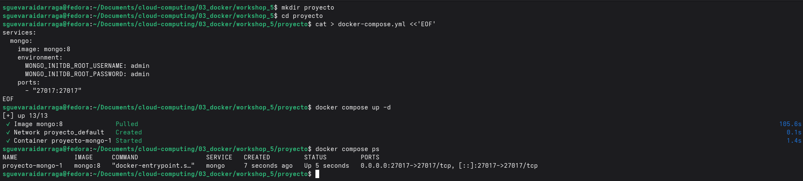
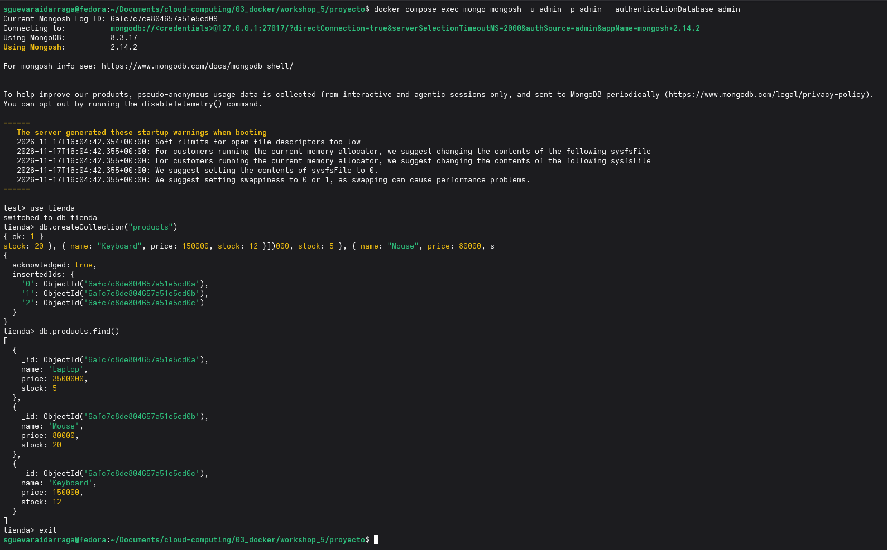
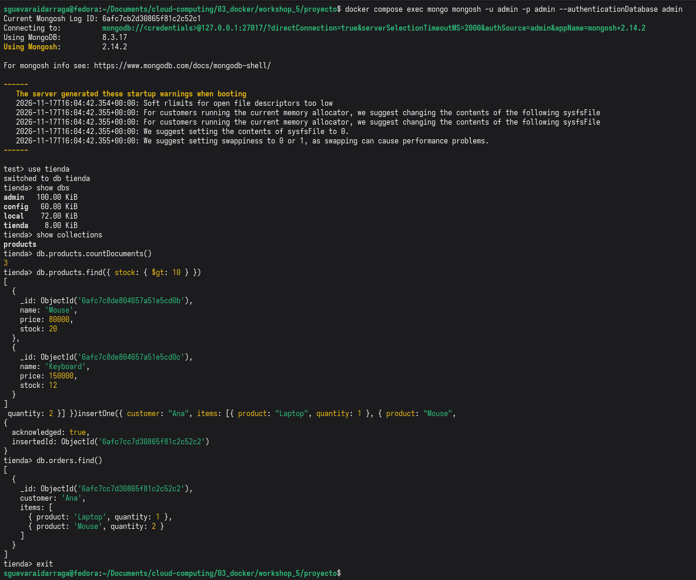
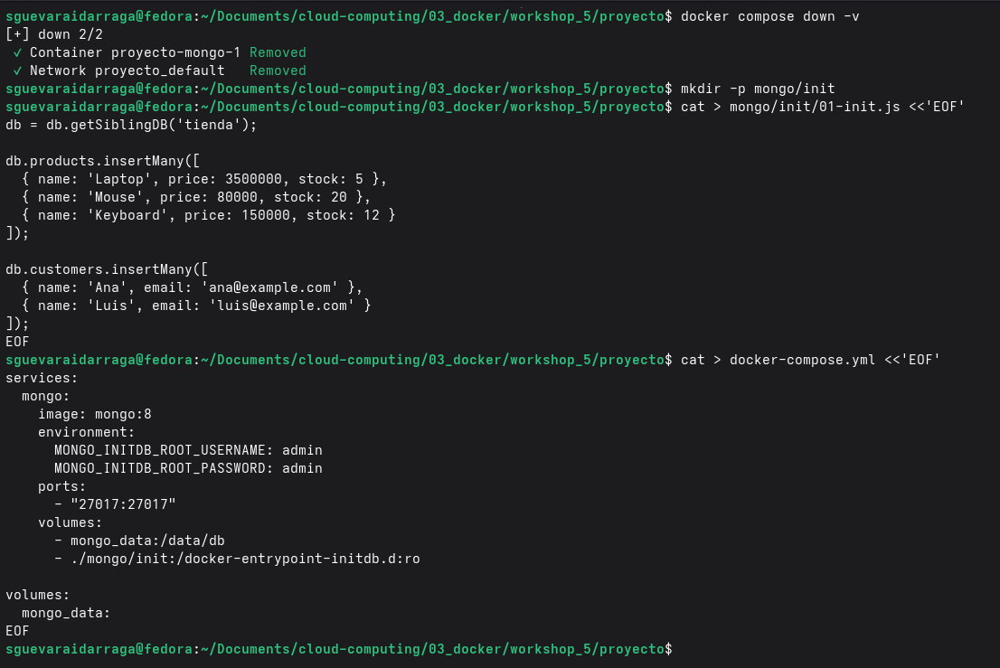
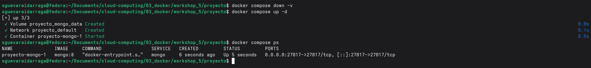
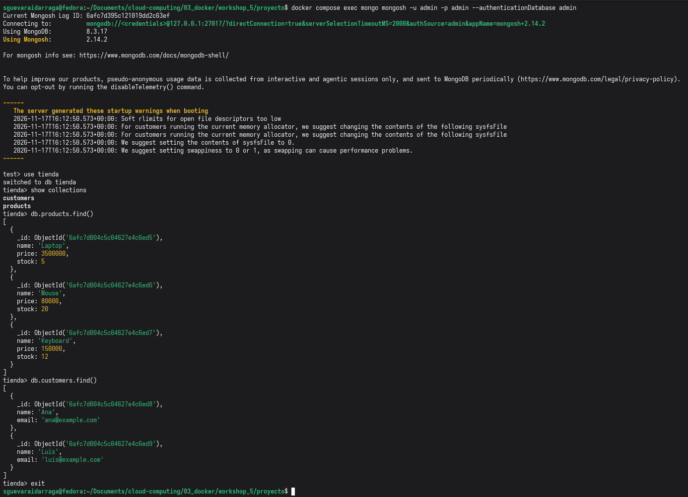
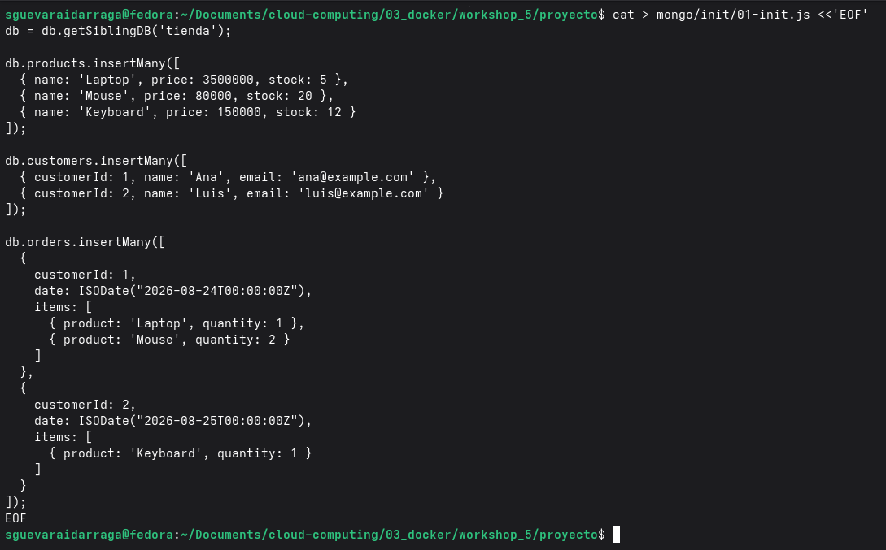
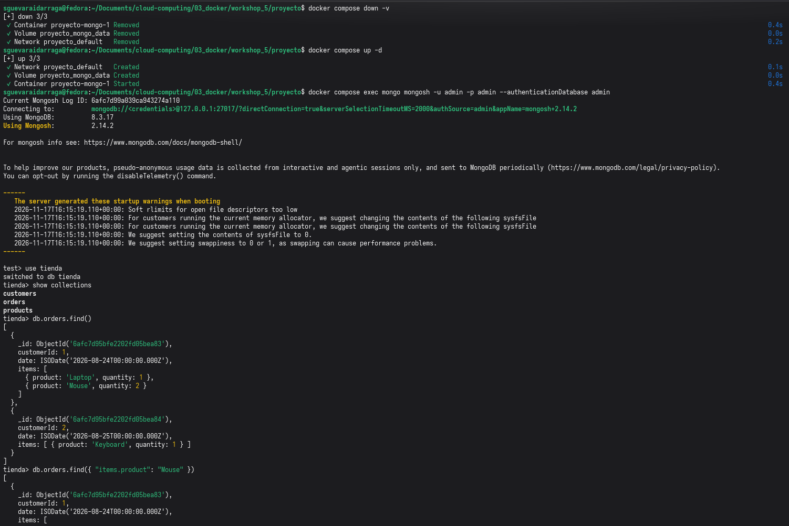
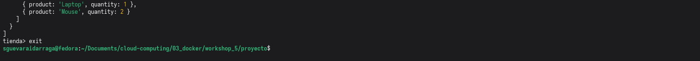

# Taller 5 - MongoDB con Docker y Docker Compose

## Parte 1. MongoDB manual

Entré con `mongosh`, creé la base `tienda`, la colección `products`, inserté tres documentos y los consulté.

## Parte 2. Explorar colecciones y documentos
Probé `show dbs`, `show collections`, `countDocuments` y un filtro con `$gt`. También inserté una orden con una lista de productos dentro del mismo documento, que es un ejemplo de estructura anidada.

## Parte 3. Automatización con JavaScript

## Parte 4. Verificar la carga automática
Recreé todo desde cero con `docker compose down -v` y `up -d`. Las colecciones y los documentos aparecen solos.

## Parte 5. Reto de modelado
Amplié el script para crear `products`, `customers` y `orders`. Cada orden guarda los productos como una lista dentro del propio documento.

## Parte 6. Comparación PostgreSQL vs MongoDB
1. Una tabla tiene columnas fijas definidas de antemano. Una colección agrupa documentos y no obliga a que todos tengan la misma estructura.
2. Una fila es un registro plano con un valor por columna. Un documento es un objeto JSON que puede tener listas y objetos dentro.
3. Permiten guardar en un solo documento datos que van juntos, como una orden con sus productos. Se leen con una sola consulta y sin hacer joins.
4. Si un dato está repetido en muchos documentos y cambia, hay que actualizarlo en todos y es fácil que queden valores distintos. También aumenta el espacio usado.
5. Catálogos de productos, perfiles de usuario, contenido de sitios, datos de sensores de IoT y aplicaciones donde la estructura de los datos cambia con frecuencia.
6. Para el ejercicio universitario es más adecuado PostgreSQL. Hay relaciones claras entre estudiantes, cursos, profesores y matrículas, y se necesitan llaves foráneas, restricciones y consultas con joins que garanticen la consistencia.
